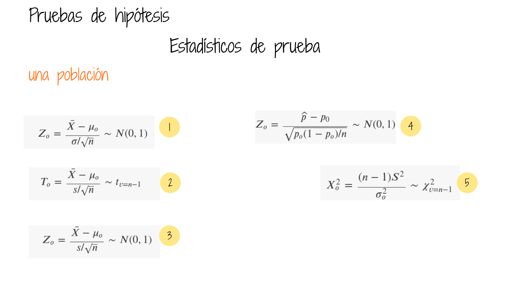

```{r setup, include=FALSE}
knitr::opts_chunk$set(echo=TRUE, message=FALSE, warning=FALSE,
                      comment=NA, fig.align="center", fig.width=8, fig.height=4.5)
# Cargar recursos locales solo si están disponibles.
if (file.exists("init.R")) source("init.R")
# Las pruebas principales emplean funciones de R base (stats).
set.seed(4301)  # Reproducibilidad de los datos simulados.
alpha <- 0.05
interpretar <- function(prueba, alpha=0.05) {
  p <- prueba$p.value
  cat(sprintf("Valor p = %.4g. %s\n", p,
              if (p < alpha) "Se rechaza H0." else "No se rechaza H0."))
}
normalidad <- function(x, nombre="Datos", alpha=0.05) {
  x <- x[is.finite(x)]
  if (length(x) < 3 || length(x) > 5000 || length(unique(x)) < 2) {
    cat(nombre, ": Shapiro-Wilk no aplicable (n entre 3 y 5000 y datos no constantes).\n")
    return(invisible(NULL))
  }
  resultado <- shapiro.test(x)
  cat("Normalidad —", nombre, "\n")
  print(resultado)
  cat(if (resultado$p.value < alpha)
      "Evidencia contra la normalidad.\n" else
      "No se detecta evidencia suficiente contra la normalidad.\n")
  invisible(resultado)
}

library(paqueteDEG)
```


```{r, echo=FALSE, out.width="85%", fig.align = "center"}
knitr::include_graphics("img/codigo4.png")
```

<br/><br/><br/>

# Pruebas paramétricas

## Pruebas de hipótesis sobre la media poblacional 


Para seleccionar una prueba sobre la media poblacional es necesario distinguir el diseño muestral, el tamaño de muestra, el conocimiento de la varianza y los supuestos de distribución. La normalidad no debe comprobarse mecánicamente en todos los casos: su importancia depende del procedimiento y de la robustez de la prueba.

```{r, echo=FALSE, out.width="82%", fig.align="center"}

```

### Ejemplo 1. Una media poblacional

Se desea contrastar $H_0:\mu=1000$ frente a $H_1:\mu\ne1000$.

```{r}
w <- round(rnorm(100, mean=1000, sd=5), 1)
summary(w)
normalidad(w, "Variable w")
qqnorm(w, main="Gráfico Q-Q: variable w"); qqline(w, col="steelblue", lwd=2)
```

**Interpretación:** Shapiro-Wilk contrasta $H_0$: los datos proceden de una distribución normal, frente a $H_1$: no proceden de una distribución normal. Si $p<\alpha$, se rechaza la normalidad; en caso contrario, **no se rechaza**, pero tampoco se demuestra que sea verdadera. El resultado depende de la muestra simulada y se calcula cada vez que se ejecuta el código.

**Cuándo usarla:** es especialmente útil para muestras pequeñas cuando el método requiere normalidad. Con muestras grandes, una prueba de normalidad puede detectar desviaciones pequeñas sin importancia práctica; conviene revisar también el gráfico Q-Q, los valores extremos, la independencia y el tamaño muestral. El teorema central del límite puede justificar una aproximación para la media, pero no garantiza robustez ante colas extremadamente pesadas o dependencia.

## Caso con variable con distribución normal y varianza conocida

<br/>

Supuestos:

|                                 |
|:--------------------------------|
| $X \sim N(\mu,\sigma^2)$                   |
| Varianza conocida ($\sigma^{2}=4$)|

<br/><br/>

```{r}
# Ilustración: sigma=2 debe ser un dato externo conocido,
# NO una estimación calculada con esta misma muestra.
sigma_conocida <- 2
z0 <- (mean(w)-1000)/(sigma_conocida/sqrt(length(w)))
p_z <- 2*pnorm(-abs(z0))
c(z=z0, valor_p=p_z)
# Si sigma no es conocida, corresponde t.test(w, mu=1000).

```
<br/><br/><br/>

## Alternativas para el planteamiento de las hipótesis

Podemos realizar pruebas de:

<br/><br/>

| Dos colas                       | Cola superior                | Cola inferior                    |
|:--------------------------------|:-----------------------------|:---------------------------------|
|$Ho$ : $\mu = \mu_o$             |$Ho$ : $\mu \leq \mu_o$       |  $Ho$ : $\mu \geq \mu_o$         |
|$Ha$ : $\mu \neq \mu_o$          |$Ha$ : $\mu > \mu_o$          |$Ha$ : $\mu < \mu_o$              |

<br/><br/>

Supuestos:

|                                 |
|:--------------------------------|
| $X \sim N(\mu,\sigma^2)$                   |
| Varianza desconocida            |

<div class="box3 with-label">
<div class="label">Nota</div> 
Una varianza poblacional se considera conocida únicamente cuando existe información externa sólida que permite tratar a $\sigma^2$ como parámetro especificado (por ejemplo, estudios previos muy fiables o un proceso estable y bien caracterizado). No es necesario ni habitual disponer de un censo.

En caso que los datos que tenemos para la varianza procedan de una muestra, el valor obtenido $s^{2}$, corresponde a una estimación de la varianza y diremos que la varianza no se conoce y que la estimamos mediante los valores de una muestra.
</div>


<br/><br/>

|                                 | 
|:--------------------------------|
| $Ho$ : $\mu \geq 5$             |
| $Ha$ : $\mu < 5$                |

<br/><br/>


```{r}
#-------------------------------------------------------------------------------
# Problema 2
muestra_t=c(4.21,5.55,3.02,5.13,4.77,2.34,5.42,4.50,6.10,3.80,5.12,6.46,6.19,3.79,3.54)
mean(muestra_t)
sd(muestra_t)
normalidad(muestra_t, "Problema 2: una media")
t.test(muestra_t,mu=5, alternative="less")
```

<br/><br/>

|                                 | 
|:--------------------------------|
| $Ho$ : $p \geq 0.76$               |
| $Ha$ : $p < 0.76$                  |

<br/>

```{r}
#-------------------------------------------------------------------------------
#Problema 3
z=(24/40-.76)/(sqrt(.76*(1-.76)/40))

# Muestra binomial: no aplicar Shapiro-Wilk a la proporción.
# En H0: n*p0=30.4 y n*(1-p0)=9.6; revisar aproximación.
prop.test(24,40,p=0.76,alternative="less",correct=FALSE)
paqueteDEG::test.prop(24,40,p=0.76 , alternative="less", conf.level = 0.95)
binom.test(24,40,p=0.76,alternative="less") # Contraste exacto
```

<br/><br/>

|                                 | 
|:--------------------------------|
| $Ho$ : $\mu_1 \geq \mu_2$       |
| $Ha$ : $\mu_1 < \mu_2$          |

<br/>

```{r}
#---------------------------------------------------------------------------------
# Problema 4
n1=36 ; mx1=6 ; sx1=4
n2=40 ; mx2=8.2; sx2=4.3

# Con solo resúmenes no se puede evaluar normalidad con Shapiro-Wilk.
# Verificar supuestos con los datos originales de cada grupo.
F=sx1^2/sx2^2
RdeRF=qf(c(0.025,0.975),35,39)

#t.test(x1,x2,mu=0, alternative = "less")
s2p=((n1-1)*sx1^2+(n2-1)*sx2^2)/(n1+n2-2)
sp=sqrt(s2p)
T4=(mx1-mx2)/(sp*sqrt(1/n1+1/n2))
RdeRT4=qt(0.05,(n1+n2-2))
```

<br/><br/><br/>

|                                 | 
|:--------------------------------|
| $Ho$ : $\mu_{g1} \geq \mu_{g2}$ |
| $Ha$ : $\mu_{g1} < \mu_{g2}$    |

<br/>

```{r}
#-----------------------------------------------------------------------------------
# Problema 5
p5=3/40
z5=(p5-0.05)/sqrt(0.05*0.95/40)
#----------------------------------------------------------------------------------
```

<br/><br/>

```{r}
# Problema 6
g1=c(75,76,74,80,72,798,76,73,72,75)
# ATENCIÓN: 798 es un posible error de digitación; confirmar fuente.
# Se conserva el valor original para evitar corregir datos sin evidencia.
g2=c(86,78,86,84,81,79,78,84,88,80)

mean(g1);sd(g1)
mean(g2);sd(g2)

normalidad(g1,"Problema 6: grupo 1")
normalidad(g2,"Problema 6: grupo 2")
boxplot(g1,g2,names=c("Grupo 1","Grupo 2"),main="Detección de atípicos")
# F clásica sensible a desviaciones de normalidad: usar solo si es justificable.
# var.test(g1,g2)
t.test(g1,g2, var.equal=FALSE) # Welch; interpretación condicionada al atípico
```

<br/><br/>

|                                 | 
|:--------------------------------|
| $Ho$ : $p_1 = p_2$              |
| $Ha$ : $p_1 \neq p_2$             |

<br/>

```{r}
#---------------------------------------------------------------------------------
# Problema 7

n1=400 ;x1=80
n2=400 ; x2=88

# Comprobar éxitos y fracasos suficientes en ambos grupos.
prop.test(c(80,88),c(400,400), correct=FALSE)
```

<br/><br/>

|                                 | 
|:--------------------------------|
| $Ho$ : $\mu_1 \geq \mu_2$       |
| $Ha$ : $\mu_1 < \mu_2$          |

<br/>


```{r}
#-----------------------------------------------------------------------------------
# Problema 8
x1=c(45,73,46,124,30,57,83,34,26,17)
x2=c(36,60,44,119,35,51,77,29,24,11)
d=x1-x2

mean(d)
sd(d)

normalidad(d,"Problema 8: diferencias pareadas")
qqnorm(d); qqline(d,col="steelblue")
t.test(x1,x2,paired=TRUE,alternative="less")
# Si la normalidad de las diferencias no es plausible,
# y se justifica la simetría, considerar wilcox.test(x1,x2,paired=TRUE).
```

<br/><br/>

|                                 | 
|:--------------------------------|
| $Ho$ : $\mu_{pa} \geq \mu_{pd}$ |
| $Ha$ : $\mu_{pa} < \mu_{pd}$    |

<br/>


```{r}
#------------------------------------------------------------------------------------
#Problema 9

pa=c(104.5,89,84.5,106,90,96,79,90,85,76.5,91.5,82.5,100.5,89.5,121.5,72)
pd=c(98,85.5,85,103.5,88.5,95,79.5,90,82,76,89.5,81,99.5,86.5,115.5,70)
d=pa-pd
mean(d)
sd(d)

normalidad(d,"Problema 9: diferencias pareadas")
t.test(pa,pd,paired=TRUE,alternative="less")
```

<br/><br/>

| Verificación de normalidad  | Comparación de varianzas                        | Diferencia de medias              |
|:----------------------------|:------------------------------------------------|:----------------------------------|   
|$Ho$ : $X_{g1} \sim norm$    |$Ho$ : $\sigma^{2}_{g1} = \sigma^{2}_{g2}$       | $Ho$ : $\mu_{g1} \geq \mu_{g2}$   | 
|$Ha$ : $X_{g1} \not\sim N$ |$Ha$ : $\sigma^{2}_{g1} \neq \sigma^{2}_{g2}$    |  $Ha$ : $\mu_{g1} < \mu_{g2}$     |

<br/>

```{r}
#-----------------------------------------------------------------------
# Problema 10
g1=c(37,19,21,35,16,4,0,12,63,25,12,15)
g2=c(24,42,18,15,0,9,10,20,22,13)

mean(g1);sd(g1)
mean(g2);sd(g2)

normalidad(g1,"Problema 10: grupo 1")
normalidad(g2,"Problema 10: grupo 2")
boxplot(g1,g2,names=c("Grupo 1","Grupo 2"),main="Detección de atípicos")
# F clásica sensible a desviaciones de normalidad: usar solo si es justificable.
# var.test(g1,g2)
t.test(g1,g2, alternative="less", var.equal=FALSE) # Welch

```


<br/><br/><br/><br/>

# Pruebas no paramétricas

<br/><br/>

**Prueba de rachas**

```{r}

library(randtests)
x=c("N","D","N","N","N","N","N","D","D","D","N","N","N","N","D","N","N","D","N","N","N","D","N","N","N","N","N","N","N","D","D","D","D")
rachas<-as.numeric(x=="N")
runs.test(rachas,alternative = "left.sided",threshold = 0.5,pvalue = "exact",plot=F)

```


<br/><br/><br/>

# Pruebas de normalidad

## ¿Cuándo se utilizan?

Las pruebas de normalidad evalúan si los datos son compatibles con una distribución normal. **No son un requisito universal previo a cualquier contraste.** Su uso debe responder al supuesto de la prueba principal y al diseño del estudio.

| Procedimiento | ¿Qué se evalúa? | Orientación |
|:--|:--|:--|
| Una media, muestra pequeña | Variable original | Shapiro-Wilk y gráfico Q-Q; comprobar independencia. |
| Dos medias independientes | Cada grupo por separado | Preferir Welch si no se asumen varianzas iguales. |
| Dos medias pareadas | Diferencias $D_i=X_{1i}-X_{2i}$ | No se exige normalidad de cada medición por separado. |
| ANOVA clásico | Residuos del modelo | Además, homogeneidad de varianzas e independencia. |
| Proporciones | No aplica normalidad de observaciones binarias | Verificar aproximación binomial o usar prueba exacta. |
| Prueba F de varianzas | Ambas poblaciones | Muy sensible a falta de normalidad. |
| Muestras grandes | Depende del estimador y los datos | Valorar robustez, asimetría, colas y valores extremos. |

## Hipótesis e interpretación

$$H_0: X \sim N(\mu,\sigma^2), \qquad H_1: X \text{ no sigue una distribución normal.}$$

Con $\alpha=0.05$, si el valor *p* es inferior a 0.05 se rechaza la hipótesis de normalidad. Si es igual o superior, no se rechaza: **ello no prueba que la población sea normal**. En muestras pequeñas puede faltar potencia y en muestras grandes se detectan desviaciones irrelevantes para el análisis.

## Ejemplo reproducible

Se conservan los datos originales del ejemplo de normalidad, pero se definen una sola vez y se reutilizan en todas las pruebas.

```{r datos-normalidad}
x <- c(946.5,  997.7, 1014.0, 1050.1,  942.3,  974.0,  997.4, 1135.8,  863.9, 1068.8,  956.9,  998.1,  997.6, 1023.4, 1008.7,  965.5,  974.8, 1063.6, 1001.2, 1090.9,  979.0,  931.5, 1018.7,  988.0,  979.9, 1043.0,  976.4, 1035.5, 1119.3,  924.3,  998.8, 1068.6,  975.5, 1037.1,  896.6,  954.7, 1029.4,  979.4,  984.1, 1004.2, 1075.1,  989.8, 1095.6, 1016.8,  909.6,  979.6, 1055.2, 1008.4, 1064.6,  994.1,  931.9,  910.8, 1045.9,  949.1, 1078.2, 1051.5,  946.9,  981.8,  988.1, 1007.5, 1082.1,  974.1, 1015.4,  961.6,  920.8,  938.1, 1008.1,  974.6, 1052.0,  986.1, 1042.3, 1014.5,  999.5,  962.0, 1024.0, 1012.4, 1014.8, 1038.4, 1084.1,  976.1,  916.2, 1023.4,  950.3, 1005.3,  945.2,  968.0, 1039.8, 1001.8,  964.4,  940.0,  982.5, 1012.9,  978.1, 1014.9,  999.0, 1031.3, 1025.6, 1034.4, 973.5, 1091.0)
hist(x, probability=TRUE, col="lightblue", border="white",
     main="Distribución observada", xlab="Valores")
lines(density(x), col="steelblue", lwd=2)
qqnorm(x, main="Gráfico Q-Q de normalidad")
qqline(x, col="firebrick", lwd=2)
```

### Shapiro-Wilk

Adecuada para detectar distintas desviaciones de normalidad. En R se implementa con `shapiro.test()` para tamaños de muestra entre 3 y 5000 y datos no constantes.

```{r}
normalidad(x,"Datos del ejemplo")
```

### Anderson-Darling, Cramér-von Mises, Lilliefors y Shapiro-Francia

Estas pruebas complementan la evaluación; no es necesario aplicarlas todas de manera rutinaria. Anderson-Darling presta especial atención a las colas; Lilliefors adapta la comparación con una normal cuyos parámetros se estiman de los datos.

```{r}
if (requireNamespace("nortest",quietly=TRUE)) {
  nortest::ad.test(x)       # Anderson-Darling
  nortest::cvm.test(x)      # Cramér-von Mises
  nortest::lillie.test(x)   # Lilliefors
  nortest::sf.test(x)      # Shapiro-Francia
} else {
  cat("Para pruebas adicionales: install.packages('nortest')\n")
}
```

### Otras pruebas: Jarque-Bera, Frosini, Geary y afines

El paquete `normtest` reúne otras alternativas. Son recursos complementarios para comparar sensibilidad a asimetría, curtosis u otras desviaciones; no reemplazan la evaluación del contexto y los gráficos diagnósticos.

```{r}
if (requireNamespace("normtest",quietly=TRUE)) {
  normtest::ajb.norm.test(x)     # Jarque-Bera ajustado
  normtest::frosini.norm.test(x)
  normtest::geary.norm.test(x)
  normtest::hegazy1.norm.test(x)
  normtest::hegazy2.norm.test(x)
  normtest::jb.norm.test(x)
  normtest::kurtosis.norm.test(x)
  normtest::skewness.norm.test(x)
  normtest::spiegelhalter.norm.test(x)
  normtest::wb.norm.test(x)
} else {
  cat("Para estas pruebas: install.packages('normtest')\n")
}
```

**Criterio de selección:** el contraste principal debe escogerse según la pregunta de investigación, el tipo de variable, el diseño y los supuestos. Un resultado significativo de Shapiro-Wilk no obliga automáticamente a utilizar una prueba no paramétrica; tampoco un resultado no significativo garantiza que la prueba paramétrica sea válida.

# Tutoriales

```{r, eval=FALSE}
install.packages("learnr") # solo una vez
install.packages("devtools") # solo una vez
devtools::install_github("dgonxalex80/paqueteDEG")
learnr::run_tutorial("Taller_pruebas1", "paqueteDEG")
```


Referencias :

https://rpubs.com/CJRR/PUJ_DECB_NP
