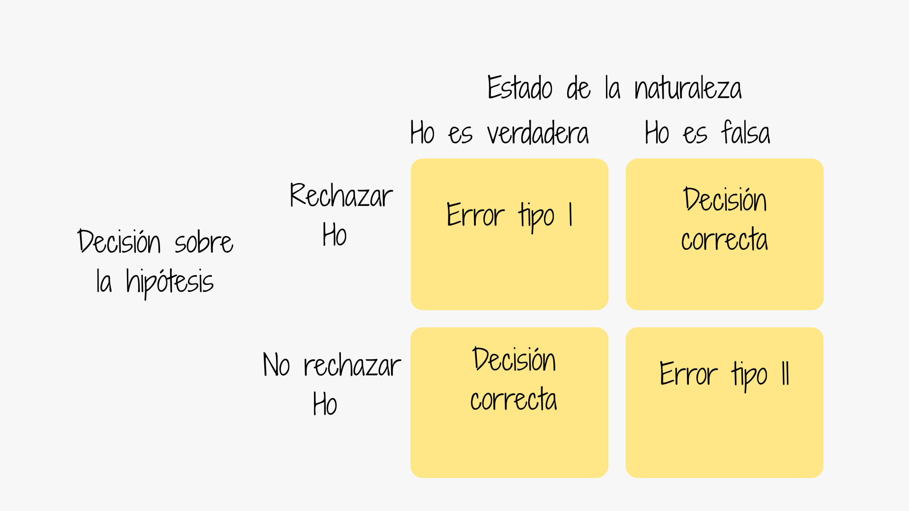
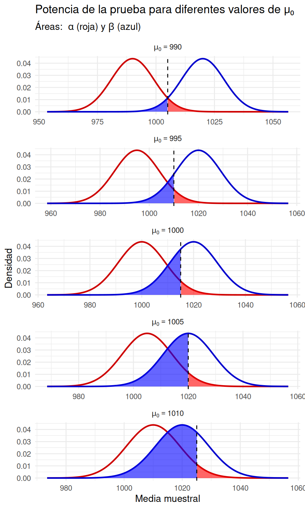
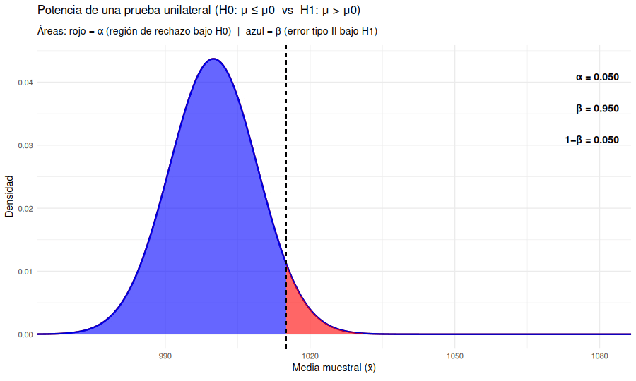
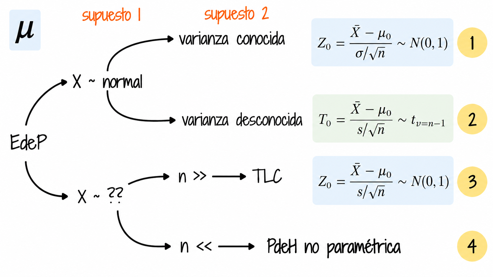
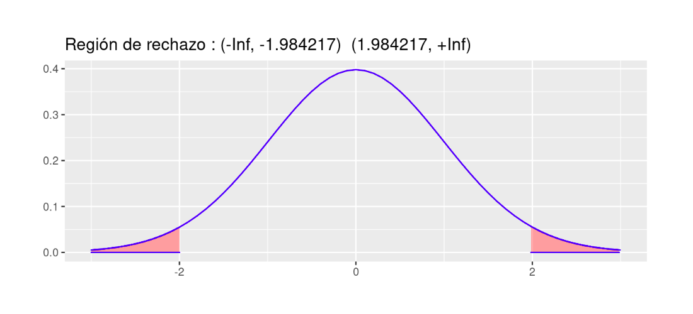
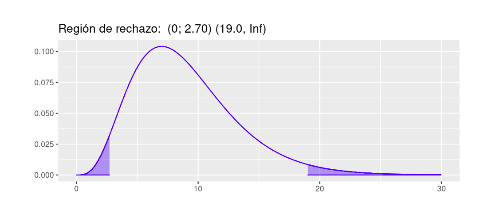
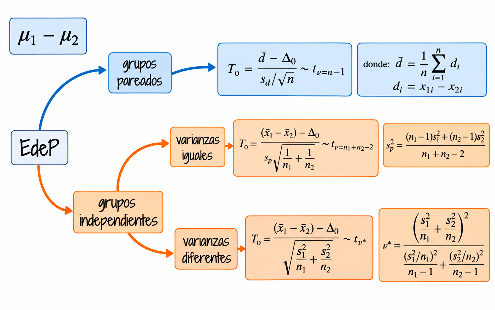
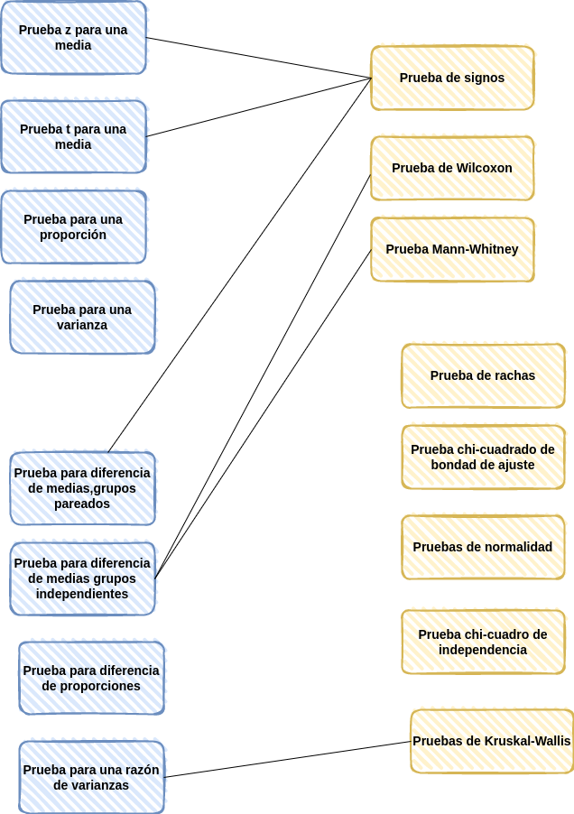
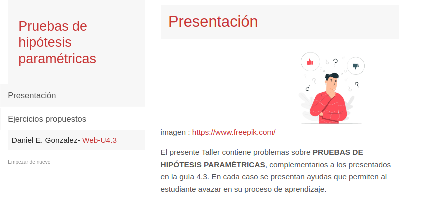

```{r setup, include=FALSE}
knitr::opts_chunk$set(comment = NA)

library(summarytools)
library(devtools)
# install_github("lchiffon/wordcloud2")
library(wordcloud)

# colores
source("init.R")

library(ggplot2)

# Función personalizada ggdistribution()
ggdistribution <- function(FUN, x, ..., colour = "black", fill = NA,
                           p = NULL, size = 1, alpha = 0.4) {
  df <- data.frame(x = x, y = FUN(x, ...))

  # Crear o continuar el objeto ggplot
  if (is.null(p)) {
    p <- ggplot(df, aes(x, y))
  }

  # Línea de densidad/masa
  p <- p + geom_line(data = df, aes(x, y), color = colour, linewidth = size)

  # Relleno del área (opcional)
  if (!is.na(fill)) {
    p <- p + geom_area(data = df, aes(x, y), fill = fill, alpha = alpha)
  }

  p
}

library(paqueteDEG)

```


```{r, echo=FALSE, out.width="92%", fig.align = "center"}
 
```

<audio controls style="width:80%;">
  <source src="audios/pdeh0.mp3" type="audio/mpeg">
</audio>


<br/><br/>


```{r, echo=FALSE, out.width="36%", fig.align = "center"}

```

<br/><br/>

# Introducción

<br/>

```{r, echo=FALSE, out.width="82%", fig.align="center"}

```

<audio controls style="width:80%;">
  <source src="audios/pdeh1.mp3" type="audio/mpeg">
</audio>


**(1) Daniel Bernoulli (1700–1782).** Matemático y físico suizo. Estudió filosofía, lógica y medicina en las universidades de Heidelberg, Estrasburgo y Basilea. Obtuvo el doctorado en Medicina en la Universidad de Basilea en 1721. Su interés por las matemáticas y la física lo llevó a realizar importantes contribuciones a la teoría de la probabilidad y sus aplicaciones científicas.

**(2) Ronald A. Fisher (1890–1962).** Estadístico y genetista británico. Estudió matemáticas en el Gonville and Caius College de la Universidad de Cambridge, donde se graduó en 1912. Su sólida formación matemática le permitió desarrollar contribuciones fundamentales a la inferencia estadística, la genética, el análisis de varianza y el diseño de experimentos.

**(3) Jerzy Neyman (1894–1981).** Matemático y estadístico polaco. Estudió matemáticas en la Universidad de Járkov, donde recibió formación en teoría de la medida y probabilidad. Obtuvo su doctorado en la Universidad de Varsovia en 1924 y posteriormente desarrolló actividades académicas e investigativas en París y Londres. Sus trabajos contribuyeron decisivamente a la teoría moderna de la inferencia estadística.

**(4) Egon S. Pearson (1895–1980).** Estadístico británico, hijo del reconocido estadístico Karl Pearson. Estudió en Winchester College y posteriormente cursó matemáticas en el Trinity College de la Universidad de Cambridge. Desarrolló gran parte de su carrera académica en el University College London, donde realizó importantes investigaciones sobre inferencia estadística y pruebas de hipótesis.

<br/><br/>

<audio controls style="width:80%;">
  <source src="audios/pdeh2.mp3" type="audio/mpeg">
</audio>


Las **pruebas de hipótesis** constituyen uno de los fundamentos de la inferencia estadística, pues proporcionan un procedimiento sistemático para evaluar afirmaciones acerca de las características de una población a partir de la información obtenida de una muestra. Su propósito es determinar si la evidencia estadística disponible resulta suficientemente incompatible con una hipótesis inicial como para justificar su rechazo, considerando la incertidumbre asociada al proceso de muestreo.

<br/>

Los antecedentes de las pruebas de hipótesis se remontan al siglo XVIII. En 1710, John Arbuthnot realizó uno de los primeros análisis que pueden interpretarse como una prueba de significación estadística, al estudiar la regularidad observada en los registros de nacimientos. Posteriormente, **Daniel Bernoulli (1)** realizó importantes contribuciones a la teoría de la probabilidad y sus aplicaciones científicas, fortaleciendo las bases matemáticas sobre las cuales se desarrollaría la inferencia estadística.

<br/>

No obstante, la formulación moderna de las pruebas de hipótesis se consolidó durante las primeras décadas del siglo XX, principalmente gracias a los aportes de **Ronald A. Fisher, Jerzy Neyman y Egon S. Pearson**, quienes desarrollaron enfoques fundamentales para evaluar hipótesis a partir de datos experimentales y observacionales.

<br/>

**Ronald A. Fisher (2)** desarrolló el enfoque de las pruebas de significación estadística, en el cual el *valor p* permite cuantificar el grado de incompatibilidad de los datos observados con la hipótesis nula. Sus contribuciones establecieron procedimientos para evaluar resultados experimentales y determinar su significación estadística.

<br/>

Por su parte, **Jerzy Neyman (3) y Egon S. Pearson (4)** desarrollaron conjuntamente, entre 1928 y 1933, una teoría formal para la contrastación de hipótesis, fundamentada en reglas de decisión y en el control de las probabilidades de cometer errores de tipo I y tipo II. Este enfoque introdujo conceptos esenciales como el nivel de significación, la potencia estadística y los criterios para seleccionar pruebas óptimas bajo determinadas condiciones.

<br/>

De estos desarrollos surgieron dos enfoques estrechamente relacionados, aunque conceptualmente diferentes: las **pruebas de significación de Fisher** y las **pruebas de hipótesis de Neyman-Pearson**. Mientras el primero se concentra en cuantificar la evidencia de los datos frente a una hipótesis nula, el segundo establece reglas de decisión que permiten controlar las probabilidades de error.

<br/>

Ambos enfoques constituyen fundamentos de la inferencia estadística contemporánea y proporcionan herramientas esenciales para la toma de decisiones bajo incertidumbre en campos como la economía, la administración, la ingeniería, la medicina y las ciencias sociales.


<br/><br/>

```{r, echo=FALSE, out.width="34%", fig.align = "center"}

```
<center>
Tomada de : https://pixabay.com/es/
</center>


<audio controls style="width:80%;">
  <source src="audios/pdeh3.mp3" type="audio/mpeg">
</audio>

<br/><br/>


Una hipótesis estadística es una afirmación o conjetura acerca de los parámetros de la distribución de probabilidades de una población. Si la hipótesis estadística especifica completamente la distribución, entonces ella se llama **hipótesis simple**, de otra manera se llama hipótesis compuesta. 

Desde el punto de vista clásico, todas las pruebas de hipótesis trabajan en base a ciertos principios que consideran:

+ Hipótesis nula ($H_0$)
+ Hipótesis alternativa ($H_a$)
+ Estadístico de Prueba (**EdeP**)
+ Región de Rechazo (**RdeR**)
+ Regla de Decisión(**RD**)

<br/><br/>

# Conceptos básicos 

<br/><br/>

<div class="box4 with-label">
<div class="label">Hipótesis Nula (Ho)</div> 

Es la afirmación inicial ($H_0$) que se somete a contrastación. Se rechaza únicamente cuando la evidencia muestral resulta suficientemente incompatible con ella; de lo contrario, no se rechaza. Esto último no significa que se haya demostrado su veracidad.
</div>

<br/><br/>

<div class="box4 with-label">
<div class="label">Hipótesis Alterna (Ha)</div> 

La hipótesis alternativa ($H_a$) plantea valores o características diferentes de los establecidos por la hipótesis nula ($H_0$). Si la evidencia muestral permite rechazar $H_0$, se considera que los datos respaldan $H_a$, sin que ello constituya una demostración absoluta de su veracidad.

</div>

<br/><br/>

<div class="box4 with-label">
<div class="label">Estadístico de Prueba</div>  

Es una función de la muestra que contiene información sobre el parámetro de interés, la que nos permite decidir sobre el rechazo de la hipótesis nula, `Ho` . Es tambien una variable aleatoria que sigue una función de distribución conocida como por ejemplo:

Para una muestra determinada se obtiene un valor del estadístico de prueba, a partir del cálculo y se determina el rechazo o no, de la hipótesis nula.

</div>

<br/><br/>


<div class="box4 with-label">
<div class="label">Región de Rechazo (RdeR)</div>  

También llamada región crítica (`RC`), define los valores del estadístico de prueba para los cuales la información muestral contradice la hipótesis nula. Estos valores nos permitirán adoptar una regla de decisión consistente. La región crítica se determina a partir de la distribución del estadístico bajo $H_0$ y del nivel de significación establecido. 

</div>

<br/><br/>


<div class="box4 with-label">
<div class="label">Regla de Decisión (RD)</div>  

Si el estadístico calculado pertenece a la región crítica, se rechaza $H_0$ en favor de $H_a$. En caso contrario, no se rechaza $H_0$, porque la muestra no proporciona evidencia suficiente para hacerlo. **No rechazar $H_0$ no equivale a demostrar que es verdadera.** 

</div>

<br/><br/>


## Errores asociados

Cuando se decide ya sea en favor o en contra de una determinada prueba de hipótesis, es posible estar en una de las cuatro situaciones descritas en la siguiente tabla:


<!-- |                   |  **Estado de la naturaleza**    |                                 | -->
<!-- |:------------------|:--------------------------------|:--------------------------------| -->
<!-- |                   |  **Ho es verdadera**            | **Ho es falsa**                 | -->
<!-- | **Decisión sobre la hipótesis**|                    |                                 | -->
<!-- |                   |                                 |                                 | -->
<!-- |Rechazar $Ho$      | **Error tipo I**                | **Decisión correcta**           | -->
<!-- |                   | P(Error tipo I) = $\alpha$      | $1-\beta$ : Potencia            | -->
<!-- |                   |                                 |                                 | -->
<!-- |No rechazar $Ho$   | **Decisión correcta**           | **Error tipo II**               | -->
<!-- |                   |                                 | P(Eror tipo II) =$\beta$        | -->
<!-- |                   |                                 |                                 | -->


```{r, echo=FALSE, out.width="76%", fig.align = "center"}

```


Existen dos situaciones en las que se comenten errores después de tomar una decisión:

<br/><br/>

<div class="box4 with-label">
<div class="label">Error tipo I</div> 

Cuando rechazamos una hipótesis nula que en realidad es verdadera. Tomando como simil la situación donde un médico desea determinar si un paciente está sano o enfermo (`Ho`: SANO vs `Ha`: ENFERMO), es posible que concluya que el paciente está enfermo (rechace `Ho`) cuando en verdad esta persona esta sana. En términos de probabilidad este error se debe de representar como:
$$P(\text{Rechazar } Ho | Ho \text{ es verdadera})= \alpha$$

</div>

<br/><br/>

<div class="box6 with-label">
<div class="label">Ejemplo 1</div>


```{r, echo=FALSE, out.width="28%", fig.align = "center"}
 
```


Para ilustrar el error tipo I, podeos acudir aun evento ocurrido a una estudiante que después de realizar una donación de sangre fue requerida por la clinica benefactora, pues el examen que le habían practicado a la sangre donada, presentaba signos de estar infectada por hepatitis c. Esto prendió las alarmas en la casa y fue llevada por la familia a que se le realizaran otros exámenes para confirmar el diagnostico inicial. Las segundas pruebas evidenciaron que se trataba de un error. Este caso constituye un caso de falso positivo (Se diagnostica como enferan, cuando en verdad esta sana) 

<audio controls style="width:80%;">
  <source src="audios/error1.mp3" type="audio/mpeg">
</audio>

</div>

<br/><br/>

<div class="box4 with-label">
<div class="label">Error Tipo II</div> 

Cuando no se rechaza una hipótesis nula que en realidad es falsa. Utilizando el ejemplo del médico, diríamos que cuando el medico indica que el paciente esta sano, cuando esta realmente enfermo, incurre en un error frecuente cuando algunos pacientes son asintomáticos y aunque tienen la enfermedad, sus exámenes médicos salen negativos. En este caso la probabilidad se representa como:

$$P(\text{No rechazar } H_0 \mid H_0 \text{ es falsa})=\beta$$
</div>

<br/><br/>

<div class="box6 with-label">
<div class="label">Ejemplo 2 </div>


```{r, echo=FALSE, out.width="30%", fig.align = "center"}
 
```


Como ilustración de un posible falso negativo, consideremos un control antidopaje que no detecta una sustancia prohibida presente en un deportista. El caso de Lance Armstrong, despojado de sus siete títulos del Tour de Francia y quien reconoció públicamente el dopaje en 2013, permite discutir las limitaciones de los sistemas de detección. **No debe inferirse que todos sus controles fueron negativos ni que cada resultado constituyó un error de tipo II.** 

<audio controls style="width:80%;">
  <source src="audios/error2.mp3" type="audio/mpeg">
</audio>

</div>

<br/><br/>

<div class="box4 with-label">
<div class="label">Nivel de significancia ($\alpha$)</div>  

No es posible minimizar simultáneamente, las probabilidades de los errores tipo I y II, ya que en la medida que uno disminuye el otro aumenta, como se muestra en la figura siguiente, en la que claramente se ve que la reducción del área $\alpha$ (probabilidad de error tipo I), implica el aumento del área $\beta$ (probabilidad de error tipo II).

</div>

<br/><br/>

<div class="box4 with-label">
<div class="label">Pruebas paramétricas</div>

Las pruebas paramétricas se basan en un modelo probabilístico caracterizado por uno o varios parámetros. Su aplicación requiere examinar los supuestos pertinentes, como la independencia, la distribución de los datos o la homogeneidad de varianzas, según la prueba utilizada. 

<audio controls style="width:80%;">
  <source src="audios/pdeh-parametricas.mp3" type="audio/mpeg">
</audio>


</div>

<br/>
<br/>
<div class="box4 with-label">
<div class="label">Potencia de una prueba de hipótesis</div>

La potencia de una prueba de hipótesis es la probabilidad de rechazar correctamente la hipótesis nula ($Ho$) cuando en realidad es falsa.

Potencia $=P(\text{Rechazar}\hspace{2mm} Ho\hspace{2mm} |\hspace{2mm} Ho \hspace{2mm}\text{es falsa}) = 1-\beta$

La potencia mide qué tan “sensible” es nuestra prueba para descubrir diferencias reales.

Una prueba con poca potencia puede pasar por alto diferencias importantes, como un detector poco calibrado.

Diseñar una buena prueba implica equilibrar $\alpha$ (riesgo de falsa alarma) y $1−\beta$ (capacidad para detectar cambios reales).

</div>

<br/><br/>

El siguiente gráfico representa los valores de $\alpha$, $\beta$ y permite visualizar el área correspondiente a $1-\beta$, es decira la potencia de  la prueba, en este caso

$$Ho: \mu \leq 1000$$
$$Ha: \mu > 1000$$


<!-- ```{r, echo=FALSE, out.width="70%", fig.align = "center"} -->
<!--  -->
<!-- ``` -->

## app.R


```{r, eval=FALSE}
# =============================================================
# app.R — Aplicación Shiny: Visualización de la potencia de una prueba
# =============================================================

# Carga las librerías necesarias
library(shiny)     # para construir la aplicación web interactiva
library(ggplot2)   # para crear los gráficos

# -------------------------------------------------------------
# 1. INTERFAZ DE USUARIO (UI)
# -------------------------------------------------------------

ui <- fluidPage(   # Crea una página fluida (responsive)
  
  # Título principal de la aplicación
  titlePanel("Potencia de una prueba de hipótesis"),
  
  # Estructura principal: panel lateral + panel central
  sidebarLayout(
    
    # Panel lateral (controles de entrada)
    sidebarPanel(
      
      # Control deslizante para el nivel de significancia α
      sliderInput("alpha", "Nivel de significancia (α):", 
                  min = 0.01, max = 0.20, value = 0.05, step = 0.01),
      
      # Campos numéricos para los parámetros de la prueba
      numericInput("mu0", "Valor de μ₀:", value = 1000, step = 10),   # valor hipotético bajo H₀
      numericInput("mu1", "Valor real de μ (μ₁):", value = 1020, step = 5), # valor verdadero bajo H₁
      numericInput("sigma", "Desviación estándar σ:", value = 50, step = 5), # desviación estándar poblacional
      numericInput("n", "Tamaño de muestra n:", value = 30, step = 1)       # tamaño de muestra
    ),
    
    # Panel principal (salidas gráficas y texto)
    mainPanel(
      plotOutput("powerPlot"),      # área donde se mostrará el gráfico
      verbatimTextOutput("resumen") # salida de texto con resultados numéricos
    )
  )
)

# -------------------------------------------------------------
# 2. SERVIDOR (SERVER)
# -------------------------------------------------------------

server <- function(input, output) {
  
  # Renderiza el gráfico de potencia
  output$powerPlot <- renderPlot({
    
    # Toma los valores ingresados por el usuario
    mu0   <- input$mu0
    mu1   <- input$mu1
    sigma <- input$sigma
    n     <- input$n
    alpha <- input$alpha
    
    # -------------------------------------------
    # Cálculos estadísticos principales
    # -------------------------------------------
    
    # Valor crítico para prueba unilateral derecha (H₁: μ > μ₀)
    z_alpha <- qnorm(1 - alpha)                     # percentil (1 - α)
    x_critico <- mu0 + z_alpha * sigma / sqrt(n)    # media muestral crítica
    
    # Cálculo de β y potencia
    z_beta <- (x_critico - mu1) / (sigma / sqrt(n)) # estandarización bajo H₁
    beta <- pnorm(z_beta)                           # probabilidad de no rechazar H₀
    potencia <- 1 - beta                            # potencia = 1 - β
    
    # -------------------------------------------
    # Preparación de los datos para graficar
    # -------------------------------------------
    
    # Secuencia de valores de la media muestral para graficar las curvas
    x <- seq(mu0 - 4 * sigma / sqrt(n), mu1 + 4 * sigma / sqrt(n), length = 1000)
    
    # Densidades bajo H₀ y H₁
    f0 <- dnorm(x, mu0, sigma / sqrt(n))  # distribución bajo H₀
    f1 <- dnorm(x, mu1, sigma / sqrt(n))  # distribución bajo H₁
    
    # Se combinan los datos en un data.frame
    df <- data.frame(x, f0, f1)
    
    # -------------------------------------------
    # Construcción del gráfico con ggplot2
    # -------------------------------------------
    ggplot(df, aes(x)) +
      
      # Curvas de densidad para H₀ (roja) y H₁ (azul)
      geom_line(aes(y = f0), color = "red3", size = 1.2) +
      geom_line(aes(y = f1), color = "blue3", size = 1.2) +
      
      # Área roja = región de rechazo (α)
      geom_area(data = subset(df, x >= x_critico),
                aes(y = f0), fill = "red", alpha = 0.5) +
      
      # Área azul = error tipo II (β)
      geom_area(data = subset(df, x < x_critico),
                aes(y = f1), fill = "blue", alpha = 0.5) +
      
      # Línea vertical en el punto crítico
      geom_vline(xintercept = x_critico, linetype = "dashed") +
      
      # Etiquetas y títulos del gráfico
      labs(title = "Distribuciones bajo H₀ y H₁",
           subtitle = "Área roja = α, Área azul = β",
           x = "Media muestral",
           y = "Densidad") +
      
      # Tema visual minimalista
      theme_minimal(base_size = 14)
  })
  
  # -------------------------------------------------------------
  # Cálculo y despliegue del resumen numérico
  # -------------------------------------------------------------
  output$resumen <- renderPrint({
    
    # Se repiten los cálculos para mostrar resultados en texto
    mu0   <- input$mu0
    mu1   <- input$mu1
    sigma <- input$sigma
    n     <- input$n
    alpha <- input$alpha
    
    # Estadísticos y probabilidades
    z_alpha <- qnorm(1 - alpha)
    x_critico <- mu0 + z_alpha * sigma / sqrt(n)
    z_beta <- (x_critico - mu1) / (sigma / sqrt(n))
    beta <- pnorm(z_beta)
    potencia <- 1 - beta
    
    # Impresión de los resultados
    cat("Resumen de la prueba:\n")
    cat("----------------------\n")
    cat("Hipótesis: H₀: μ ≤", mu0, "  vs  H₁: μ >", mu0, "\n")
    cat("Valor crítico =", round(x_critico, 2), "\n")
    cat("Probabilidad de error tipo I (α) =", alpha, "\n")
    cat("Probabilidad de error tipo II (β) =", round(beta, 4), "\n")
    cat("Potencia de la prueba = 1 - β =", round(potencia, 4), "\n")
  })
}

# -------------------------------------------------------------
# 3. LANZAR LA APLICACIÓN
# -------------------------------------------------------------
shinyApp(ui, server)

```


<br/><br/>

```{r, echo=FALSE, out.width="75%", fig.align = "center"}

```

<audio controls style="width:80%;">
  <source src="audios/potencia.mp3" type="audio/mpeg">
</audio>

<br/><br/>


# Puebas de hipótesis sobre una población

Los parámetros más importante a los que se les realizan pruebas de hipótesis son : $\mu$, $p$ y $\sigma^{2}$, en el caso de una población :  

<br/><br/>

| parámetro    |  prueba de dos colas    | prueba de cola inferior| prueba de cola superior|
|:-------------|:------------------------|:-----------------------|:-----------------------|
|$\mu$         |$Ho: \mu = \mu_{o}$      |$Ho: \mu \geq \mu_{o}$  |$Ho: \mu \leq \mu_{o}$  |
|              |$Ha: \mu \neq \mu_{o}$   |$Ha: \mu < \mu_{o}$     |$Ha: \mu > \mu_{o}$     |
|              |                         |                        |                        |
|$p$           |$Ho: p = p_{o}$          |$Ho: p \geq p_{o}$      |$Ho: p \leq p_{o}$      |
|              |$Ha: p \neq p_{o}$       |$Ha: p < p_{o}$         |$Ha: p > p_{o}$         |
|              |                         |                        |                        |
|$\sigma^{2}$  |$Ho: \sigma^{2} = \sigma^{2}_{o}$   |$Ho: \sigma^{2} \geq \sigma^{2}_{o}$ |$Ho: \sigma^{2} \leq \sigma^{2}_{o}$|
|              |$Ha: \sigma^{2} \neq \sigma^{2}_{o}$|$Ha: \sigma^{2} < \sigma^{2}_{o}$   |$Ha: \sigma^{2} > \sigma^{2}_{o}$  |

<br/><br/>

# Pruebas de hipótesis sobre una media

Dependiendo de las condiciones podemos optar por tres diferentes EdeP para la realización de la prueba para una media, aunque tenemos una cuarta posibilidad en el caso de realizarla mediante un método no paramétrico:

<br/><br/>

```{r, echo=FALSE, out.width="78%", fig.align = "center"}

```


<br/>
<br/>
<div class="box6 with-label">
<div class="label">Ejemplo 3</div>

Un informe indica que el precio medio del pasaje de avión entre Cali  y San Andrés  es de \$120 mil pesos  y su desviación estándar de \$40 mil pesos. Se toma una muestra que se registra a continuación. ¿Se puede aceptar, con un nivel de significación igual a $\alpha=0.1$, las afirmaciones acerca de la media? |
  
165.1, 91.8, 128.3, 160.3, 103.6, 153.2, 50.7, 150.3, 160.8, 38.1, 98.8, 88.7, 123.1, 106.5, 79.5, 84.1, 216.1, 139.8, 98.4, 127.1, 103.0, 83.7, 158.8, 126.1, 113.4, 61.3, 79.8, 121.8, 89.9, 97.4, 134.0, 141.2, 154.3, 122.4, 107.6, 137.7, 121.0, 187.7, 56.8, 79.5, 183.8, 114.7, 80.2, 97.3, 113.8, 92.4, 123.5, 138.4, 114.7, 48.8, 178.1, 106.0, 103.1, 100.8, 180.7, 113.1, 121.4, 163.0, 51.4, 135.5,104.5, 202.1, 171.0, 100.7, 56.4, 99.7, 93.0, 118.3, 110.4, 136.9, 112.3, 69.8, 138.3, 87.2, 121.8, 118.6, 174.5, 77.7, 158.5, 85.3, 71.4, 63.0, 140.9, 126.9, 194.2, 136.7, 98.8, 222.5, 131.3, 175.0, 127.7, 88.5, 104.5, 144.7, 73.0, 97.2, 131.0, 120.5, 166.6, 96.0 . 

</div>

<br/><br/>

## Solución

Las pruebas a contrastar son:

$Ho: \mu= 120$ <br/>
$Ha: \mu \neq 120$ 

<br/><br/>

Antes de realizar la prueba debemos de determinar si la distribución de la población de precios es normal, para lo cual realizaremos la prueba de normalidad de Shapiro Wilk

$Ho: X \hspace{0.3cm}\sim norm$ <br/>
$Ha: X \hspace{.3cm} no \sim norm$ <br/>


```{r}
precio=c(165.1, 91.8, 128.3, 160.3, 103.6, 153.2, 50.7, 150.3, 160.8, 38.1, 98.8, 88.7, 123.1, 106.5, 79.5, 84.1, 216.1, 139.8, 98.4, 127.1, 103.0, 83.7, 158.8, 126.1, 113.4, 61.3, 79.8, 121.8, 89.9, 97.4, 134.0, 141.2, 154.3, 122.4, 107.6, 137.7, 121.0, 187.7, 56.8, 79.5, 183.8, 114.7, 80.2, 97.3, 113.8, 92.4, 123.5, 138.4, 114.7, 48.8, 178.1, 106.0, 103.1, 100.8,180.7,113.1,121.4,163.0,51.4,135.5,104.5,202.1,171.0,100.7, 56.4, 99.7, 93.0, 118.3, 110.4, 136.9, 112.3, 69.8, 138.3, 87.2, 121.8, 118.6, 174.5, 77.7, 158.5, 85.3, 71.4, 63.0, 140.9, 126.9, 194.2, 136.7, 98.8, 222.5, 131.3, 175.0, 127.7, 88.5, 104.5, 144.7, 73.0, 97.2, 131.0, 120.5, 166.6, 96.0)
boxplot(precio, horizontal = TRUE, col = c40, xlab="precio ($000)")
```

<br/><br/>

```{r}
shapiro.test(precio)
```

<br/>

De acuerdo con los resultados obtenidos en la prueba de Shapiro podemos suponer y aplicando la regla 3 (que se trata más adelante) podemos suponer que los datos siguen una distribucion aproximadamente normal. Cumplido este supuesto y al no tener conocimiento del valor de la varianza utilizaremos una prueba t para una media


```{r}
t.test(precio,
       alternative = "two.sided", # tipo de prueba
       mu = 120,                  # valor a contrastar
       conf.level = 0.90)         # nivel de confianza
```
<br/>

Para tomar una decisión sobre las hipótesis de acuerdo con los resultados podemos utilizar tres reglas:

<br/><br/>

<div class="box4 with-label">
<div class="label">Regla 1 :</div> 


Si el `EdeP` cae en la `RdeR`, entonce se RECHAZA la `Ho` y se **acepta** `Ha` como verdadera. Si por el contrario el `EdeP` NO cae en la `RdeR`, entonces NO SE RECHAZA `Ho`, no existe suficiente evidencia para rechazarla, **asumimos** que `Ho` es verdad.


<audio controls style="width:80%;">
  <source src="audios/regla1.mp3" type="audio/mpeg">
</audio>

</div>


En este caso es necesario determinar la región de rechazo (`RdeR`) de acuerdo al tipo de hipótesis y a la distribución del estadistico de prueba. En esta caso estamos realizando una prueba de dos colas, para un estadistico de prueba con distribución t-Student con 99 grados de libertad.

<br/><br/>


## Región de Rechazo 

Para determinar la `RdeR`, a a prtir del nivel de significancia asumido, se buscan los percentiles $t_{0.025; v=59}$ y $t_{0.975;v=59}$ para la distribución t-Student.

```{r}
qt(c(0.025,0.975),99)
```

<br/><br/>

```{r,eval=FALSE, fig.width=7, fig.height=3}
library(ggdistribute)
p=ggdistribution(dt, seq(-3, +3, 0.1), df = 99, colour = "blue")
p=ggdistribution(dt, seq(-3, qt(0.025,99), 0.1), df = 99, colour = 'blue', fill="red", p=p)   
p=ggdistribution(dt, seq(qt(0.975,99),+3, 0.1), df = 99, colour = 'blue', fill="red", p=p)+ 
     ggtitle("Región de rechazo : (-Inf, -1.984217)  (1.984217, +Inf)")
p
```


```{r, echo=FALSE, out.width="76%", fig.align = "center"}

```

<br/><br/>

## Conclusión: 

Como el `EdeP` (`t = -0.39343`) NO cae en la `RdeR`, entonces NO rechazamos `Ho`, asuminos `Ho` es verdadera, es decir $\mu$ de los precios es igual a 120 mil pesos. 


<br/><br/>

<div class="box4 with-label">
<div class="label">Regla 2:</div>

Si $\alpha >$ **valor-p** entonces rechazamos $H_{0}$, se **acepta** `Ha` como verdadera. Si por el contrario $\alpha <$ `valor-p`, no rechazamos `Ho`, **asumimos** 	que `Ho` es verdad. 

<audio controls style="width:80%;">
  <source src="audios/regla2.mp3" type="audio/mpeg">
</audio>
</div>

<br/>
<br/>
<div class="box4 with-label">
<div class="label">Valor-p </div> 

El valor-p corresponde al área delimitada por el `EdeP` en el sentido que indica la `RdeR` de la prueba a contrastar. Es decir que corresponde a la probilidad  máxima de cometer `error tipo I`.

[Gil, Jacky F.; Castañeda, Javier A (2005)](https://www.redalyc.org/pdf/806/80634308.pdf) lo definen como :

*El resultado de la prueba de hipótesis se basa principalmente en el cálculo, en términos de probabilidad, de la fuerza de los hallazgos a favor de la hipótesis nula. Esta probabilidad recibe el nombre de valor-p, y se define como la probabilidad de cometer un falso positivo por efecto del azar, cuando la hipótesis nula es verdadera.*


</div>

<br/><br/>

## Conclusión: 

Como el valor de $\alpha >$ `valor-p`  (0.05 > p-value = 0.6949) entonces No se rechaza `Ho`, se `ASUME` que 	`Ho` es verdad. El promedio de los precios es igual a \$ 120.  

<br/><br/>

<div class="box6 with-label">
<div class="label">Regla 3 : </div> 

El `valor-p` se interpreta como el error que puedo cometer al rechazar `Ho`, siendo esta verdadera (cometer `error tipo I`). Si este valor es considerado como pequeño, rechazo `Ho`, se `ACEPTA` `Ha`. Si por el contrario se considera este valor grande, entonce no rechazo `Ho`, asumo que `Ho` es verdad.

<audio controls style="width:80%;">
  <source src="audios/regla3.mp3" type="audio/mpeg">
</audio>

</div>

<br/><br/>

## Conclusión: 

En este caso valoramos si el `valor-p` (p-value = 0.6949) es grande o pequeño. En esta caso se puede considerar que su valor es muy grande y por lo tanto no nos atrevemos a rechazar `Ho`, asumimos que $Ho$ es verdadera, es decir que la media de los precios es igual a \$ 120. 

<br/><br/>

<div class="box2 with-label">
<div class="label">Nota</div>

 Al aplicar las últimas dos reglas (`Regla 2` y `Regla 3`) no se requiere la construcción de una `Región de de Rechazo` para tomar la decisión. Solo con revisar el `valor-p` entregado por la prueba y aplicar la regla se toma la decisión. En adelante utilizaremos las reglas 2 y 3 dado que al ejecutar las funciones  en `R` nos sumunistran información sobre `valor-p`.

</div>

<br/><br/>

<div class="box6 with-label">
<div class="label">Reto</div>

 Una operación en una línea de producción debe llenar cajas con detergente hasta un peso promedio de 32 onzas. Periódicamente se selecciona una muestra de cajas llenas, que se pesan para determinar a partir del promedio, si están faltas o sobradas de detergente. Si los datos de la muestra llevan a la conclusión de que les falta o sobra detergente, se debe parar la línea de producción y hacer los ajustes necesarios para que el llenado sea correcto. Con el fin de afianzar los conceptos expuestos, te invito a responder los siguientes interrogantes :

(a.) Formule la hipótesis nula y alternativa que lleven a decidir si es conveniente parar y ajustar la línea de producción o no. 

(b.) Comente la conclusión a que se llegaría en caso de que se rechace  $H_o$ y cuando no se rechace $H_o$. 

(c.) Cuándo se comete error tipo I y cuando el tipo II. 

(d.) Bajo condiciones de distribución normal, determine la región de rechazo para una $\alpha= 0.05$ y para $\alpha= 0.08$  

</div>

<br/><br/>

# Pruebas de hipótesis sobre una proporción

En este caso debemos tener en cuenta que la muestra sea mayor a 30 con el fin de tener estimaciones mas robustas para estimar la proporción poblacional.


<br/><br/>

<div class="box6 with-label">
<div class="label">Ejemplo 4</div> 

Una empresa al seleccionar su personal, lo somete a un curso de entrenamiento. Por su experiencia se conoce que el 76% de los aspirantes aprueban el curso. Durante el último proceso, los encargados efectúan cambios al programa de entrenamiento, con el fin de realizar una selección más exigente. Para esta versión se inscriben 40 aspirantes de los cuales lo aprueban el proceso 24. ¿Podría afirmarse que los cambios realizados en el programa de entrenamiento reducen la selección? 

</div>

<br/>

Debemos realizar una prueba de cola inferior debido al sentido que tienen la afirmación que queremos verificar *los cambios realizados en el programa de entrenamiento reducen la selección*. 

Ho: $p \geq 0.76$ <br/>   
Ha :$p < 0.76$   <br/>

<br/>


Estadístico de prueba chi-cuadrado

```{r}
prop.test(24, 40, p = 0.76,
          alternative = "less",
          conf.level = 0.95)
```

<br/>

Estadístico de prueba Z (paqueteDEG)

```{r}
paqueteDEG::test.prop(24, 40, p = 0.76,
  alternative = "less",
  conf.level = 0.95
)
```


<br/><br/>

## Conclusión

Como el `valor-p` (p-value = 0.01447) es menor que el nivel de significancia ($\alpha=0.05$), rechazamos la hipótesis nula, aceptamos la hipótesis alterna. Podemos afirmar que $p<0.76$ . Tienen razón al afirmar que los cambios realizados en el proceso de selección provocaron una disminución significativa en la proporción de aprobación.


<audio controls style="width:80%;">
  <source src="audios/ejemplo4.mp3" type="audio/mpeg">
</audio>


<br/><br/>

# Pruebas de hipótesis sobre una varianza

<br/><br/>

<div class="box6 with-label">
<div class="label">Ejemplo 5</div> 

Un fabricante de baterías para celulares afirma que el tiempo de duración de sus baterías se distribuyen aproximadamente normal con una desviación estándar de 9 horas. Un comprador antes de realizar un pedido de este producto solicita al fabricante una muestra de 10 baterías para verificar la información que le esta dando. Con este propósito son enviadas al laboratorio y se obtienen los siguientes datos Es cierta la información suministrada por el fabricante? 

<pre>
11.1, 15.6, 11.1, 7.5, 7.9, 14.7, 6.3, 8.5, 8.0 , 7.6   
</pre>

</div>

<br/><br/>

```{r, eval=FALSE, fig.width=7, fig.height=3}
library(ggdistribute)
pRdeR=qchisq(c(0.025,0.975),9)
p=ggdistribution(dchisq, seq(0, 30, 0.1), df = 9, colour = 'blue')
p=ggdistribution(dchisq, seq(0, pRdeR[1], 0.1), df = 9, colour = 'blue', fill="blue", p=p)
p=ggdistribution(dchisq, seq(pRdeR[2], 30, 0.1), df = 9, colour = 'blue', fill="blue", p=p)+
       ggtitle("Región de rechazo:  (0; 2.70) (19.0, Inf) ")
p
pRdeR
```


```{r, echo=FALSE, out.width="76%", fig.align = "center"}

```


```{r}
t=c(11.1, 15.6, 11.1, 7.5, 7.9, 14.7, 6.3, 8.5, 8.0 , 7.6)
varx=var(t)
EdeP=(length(t)-1)*varx/81
EdeP
```

<br/><br/>

## Conclusión

Como el $EdeP$ (1.135074) caen en la $RdeR$, entonces rechazamos la hipótesis nula, aceptamos la hipótesis alterna como verdadera.

Podemos entonce concluir que $\sigma^{2} \neq 81$


<br/>
<br/>

# Prueba de hipótesis sobre dos poblaciones

<br/><br/>


| parámetro       |  prueba de dos colas    | prueba de cola inferior| prueba de cola superior|
|:----------------|:------------------------|:-----------------------|:-----------------------|
|$\mu_{1}-\mu_{2}$|$Ho: \mu_{1}-\mu_{2}=\Delta_{o}$|$Ho: \mu_{1}-\mu_{2} \geq=\Delta_{o}$  |$Ho: \mu_{1}-\mu_{2}\leq\Delta_{o}$  |
|                 |$Ha: \mu_{1}-\mu_{2} \neq \Delta_{o}$|$Ha: \mu_{1}-\mu_{2} <\Delta_{o}$ |$Ha: \mu_{1}-\mu_{2} > \Delta_{o}$   |
|                 |                                  |                        |                        |
|                 |                                  |                        |                        |
|                 |                                  |                        |                        |
|$p_{1}-p_{2}$    |$Ho: p_{1}-p_{2} = \Delta_{o}$    |$Ho: p_{1}-p_{2} \geq\Delta_{o}$      |$Ho: p_{1}-p_{2} \leq \Delta_{o}$      |
|                 |$Ha: p_{1}-p_{2} \neq \Delta_{o}$ |$Ha: p_{1}-p_{2} < \Delta_{o}$        |$Ha: p_{1}-p_{2} > \Delta_{o}$      |
|                 |                         |                        |                        |
|                 |                                  |                        |                        |
|                 |                                  |                        |                        |
|$\sigma_{1}^{2}/\sigma_{2}^{2}$ |$Ho: \sigma_{1}^{2} = \sigma^{2}_{2}$   |$Ho: \sigma_{1}^{2} \geq \sigma_{2}^{2}$ |$Ho: \sigma_{1}^{2} \leq \sigma_{2}^{2}$|
|                                |$Ha: \sigma_{1}^{2} \neq \sigma^{2}_{2}$|$Ha: \sigma_{1}^{2} < \sigma_{2}^{2}$    |$Ha: \sigma_{1}^{2} > \sigma_{2}^{2}$  |


<br/><br/>

## Comparación de medias 


```{r, echo=FALSE, out.width="78%", fig.align = "center"}

```


<br/><br/>

## Caso grupos pareados

<br/>

<div class="box6 with-label">
<div class="label">Ejemplo 6</div> 

 El director de un gimnasio requiere determinar si contrata o no a un instructor para su campaña de reducción de peso. Para tomar la decisión decide tomar un grupo de 16 personas que acuden normalmente para darle una oportunidad a un aspirante al cargo. Los siguientes datos corresponden a los resultados obtenidos antes y después de un mes de estar en el programa. Utilice un nivel de significancia $\alpha= 0.10$, para determinar si contrata o no al aspirante.|

|     |     |     |     |     |     |     |     |     |     |     |     |     |     |     |     |     |
|:----|----:|----:|----:|----:|----:|----:|----:|----:|----:|----:|----:|----:|----:|----:|----:|----:|     
|pant |104.5|89   |84.5 |106  |90   |96   |79   |90   |85   |76.5 |91.5 |82.5 |100.5| 89.5|121.5| 72  |
|pdes | 98  |85.5 |85   |103.5|88.5 |95   |79.5 |90   |82   |76   |89.5 |81   | 99.5| 86.5|115.5| 70  |


</div>

<br/>

Ho: $\mu_{ant} \geq \mu_{des}$ <br/>
Ha: $\mu_{ant} < \mu_{des}$ <br/>


```{r}
pant=c(104.5,89,84.5,106,90,96,79,90,85,76.5,91.5,82.5,100.5,89.5,121.5,72)
pdes=c(98,85.5,85,103.5,88.5,95,79.5,90,82,76,89.5,81,99.5,86.5,15.5,70)

t.test(pant, pdes,
       alternative = "less",
       mu = 0, 
       paired = TRUE, 
       conf.level = 0.95)

```


<br/><br/>

## Conclusión

Como el `valor-p` ( 0.8889) es mayor que nuestro nivel de significancia ($\alpha= 0.10$), no se rechaza la hipótesis nula, no existe suficiente evidencia en la muestra que permita rechazarla. Se asume que Ho es verdad. Es decir que no hay evidencia que el programa reduzca el peso.


<br/>
<br/>
## Caso grupos independientes con varianzas iguales

$S_1$: variables con distribución normal
$S_2$: varianzas iguales


<div class="box6 with-label">
<div class="label">Ejemplo 7</div> 
Una empresa desarrolla un curso de entrenamiento para sus empleados, formando dos grupos y aplicando dos metodologías diferentes de entrenamiento con el fin de poder evaluar que método produce los mejores resultados. El primer grupo (g1) esta conformado por 36 empleados y el segundo grupo (g2) por 40 empleados . Se puede afirmar que el método aplicado al segundo grupo produce mejores resultados que el aplicado al primer grupo ? ¿Que supuestos debe tener en cuenta? 

<pre>
Grupo 1  6.8, 6.1, 5.8, 5.9, 5.8, 6.4, 5.7, 6.0, 5.9, 6.4, 6.0, 5.7, 
         6.5, 6.5, 6.0, 5.9, 5.7, 5.8, 5.9, 5.8, 6.0, 6.0, 5.8, 5.7, 
         6.1, 5.9, 5.2, 6.3, 5.4, 6.5, 5.5, 5.9, 7.0, 6.4, 5.1, 6.3
         
Grupo 2  8.8, 8.5, 8.4, 8.5, 7.6, 8.7, 8.0, 7.9, 8.2, 8.0, 7.8, 8.6, 
         8.5, 7.9, 8.5, 8.3, 8.4, 8.2, 8.3, 7.9, 8.2, 7.7, 7.8, 7.7, 
         8.1, 8.0, 8.3, 8.2, 8.1, 8.3, 8.1, 8.8, 7.7, 9.1, 7.6, 8.4, 
         8.2, 8.3, 8.1, 8.7  
</pre>


```{r}
grupo1=c(6.8, 6.1, 5.8, 5.9, 5.8, 6.4, 5.7, 6.0, 5.9, 6.4, 6.0, 5.7, 
         6.5, 6.5, 6.0, 5.9, 5.7, 5.8, 5.9, 5.8, 6.0, 6.0, 5.8, 5.7, 
         6.1, 5.9, 5.2, 6.3, 5.4, 6.5, 5.5, 5.9, 7.0, 6.4, 5.1, 6.3)

grupo2=c(8.8, 8.5, 8.4, 8.5, 7.6, 8.7, 8.0, 7.9, 8.2, 8.0, 7.8, 8.6, 
         8.5, 7.9, 8.5, 8.3, 8.4, 8.2, 8.3, 7.9, 8.2, 7.7, 7.8, 7.7, 
         8.1, 8.0, 8.3, 8.2, 8.1, 8.3, 8.1, 8.8, 7.7, 9.1, 7.6, 8.4, 
         8.2, 8.3, 8.1, 8.7)

par(mfrow = c(1, 2))
boxplot(grupo1, las=1, col=c20, ylim=c(5,10))
boxplot(grupo2, las=1, col=c40, ylim=c(5,10))
```

</div>

<br/><br/>

Iniciaremos con una prueba de hipótesis para la comparación de varianzas:

Ho:$\sigma^{2}_{1} = \sigma^{2}_{2}$<br/>

Ha:$\sigma^{2}_{1} \neq \sigma^{2}_{2}$<br/>
<br/>
```{r}
var.test(grupo1,grupo2)
```

<br/><br/>

## Conclusión

Como el `valor-p` (0.4282) es mayor al nivel de significancia ($\alpha=0.05$), no rechazamos la hipótesis nula, no existe suficiente evidencia en la muestra que permita rechazarla, asumimos que las varianza son iguales.

<br/><br/>

Ho: $\mu_{1} \geq \mu_{2}$ <br/>
Ha: $\mu_{1} < \mu_{2}$ <br/>

<br/>

```{r}
t.test(grupo1, grupo2,
       alternative ="less",
       mu = 0, 
       paired = FALSE, 
       var.equal = TRUE,
       conf.level = 0.95)
```
<br/><br/>

## Conclusión

Como el `valor-p` (2.2e-16) es menor que el nivel de significancia, rechazamos la hipótesis nula, aceptamos como verdadera la hipótesis alterna. La media el primer grupo es significativamente menor que la media obtenida por el segundo grupo. Esto indica que el método aplicado al segundo grupo produce mejores resultados. 

<br/>
<br/>
## Caso grupos independientes con varianzas diferentes

$S_1$: variables con distribución normal
$S_2$: varianzas diferentes

<br/><br/>

<div class="box6 with-label">
<div class="label">Ejemplo 8</div> 

 Supongamos que la empresa del ejemplo 8, desea comparar los resultados obtenidos por el grupo 2 con un tercer grupo externo con el fin de realizar una valoración adicional que le permita una visión más general de los métodos empleados 

<br/><br/>

```{r}


grupo3=c(8.4, 7.5, 6.9, 6.6, 7.0, 5.5, 5.5, 7.9, 6.9, 7.3, 4.7, 5.5, 6.7, 8.3, 
         6.0, 6.3, 5.5, 8.4, 7.1, 5.3, 6.9, 5.5, 7.2, 6.5, 6.1, 7.8, 7.4, 6.6, 
         6.8, 6.0, 6.9, 7.4, 4.9, 6.2, 7.3, 6.2)

grupo2=c(8.8, 8.5, 8.4, 8.5, 7.6, 8.7, 8.0, 7.9, 8.2, 8.0, 7.8, 8.6, 8.5, 7.9, 
         8.5, 8.3, 8.4, 8.2, 8.3, 7.9, 8.2, 7.7, 7.8, 7.7, 8.1, 8.0, 8.3, 8.2, 
         8.1, 8.3, 8.1, 8.8, 7.7, 9.1, 7.6, 8.4, 8.2, 8.3, 8.1, 8.7)

par(mfrow = c(1, 2))
boxplot(grupo3, las=1, col=c20, ylim=c(5,10))
boxplot(grupo2, las=1, col=c40, ylim=c(5,10))
```

```{r}
var.test(grupo3,grupo2)
t.test(grupo3, grupo2,
       alternative ="less",
       mu = 0, 
       paired = FALSE, 
       var.equal = FALSE,
       conf.level = 0.95)

```

</div>


<br/>

En este caso tenemos una comparación de medias para grupos independientes con varianzas diferentes (como se muestra en el resultado de var.test) .

<br/><br/>

## Conclusión

Analizando el resultado de la prueba t-Student, el `valor-p` resultante (3.781e-12) indica que se rechaza la hipótesis nula, se acepta la hipótesis alterna como verdadera. Podemos afirmar que existen diferencias significativas entre las dos medias.


<br/>
<br/>
## **Pruebas de hipótesis para diferencia de proporciones

<br/>

<div class="box6 with-label">
<div class="label">Ejemplo 9</div> 

Una encuesta realizada a 100 usuarios de una tarjeta de crédito seleccionados aleatoriamente, 57 dijeron que sabían que empleando su tarjeta podían ganar millas de viajero. Después de una campaña publicitaria para difundir este beneficio, se realizo una encuesta independiente entre 150 usuarios de la tarjeta de crédito y 87 informaron que conocían el beneficio. ¿Se puede concluir que el conocimiento de este beneficio aumento después de la campaña publicitaria? 

</div>

<br/><br/>

Ho: $p_{1} \geq p_{2}$ <br/>
Ha: $p_{1} < p_{2}$ <br/>

<br/>

```{r}
prop.test(c(57,87),c(100,150),
          p = NULL,
          alternative = "less",
          conf.level = 0.95)
```
<br/><br/>

## Conclusión

Como el `valor-p` ( 0.4896) es mayor al nivel de significancia, no se rechaza la hipótesis nula, no existe suficiente evidencia en la muestra que permita rechazarla, asumimos que Ho es verdad. Por tal motivo no se perciben mejoras el conocimiento de los beneficios que trae el uso de la tarjeta de crédito.  Se recomienda revisar la forma en que se realiza la campaña publicitaria.

<br/>
<br/>
# Pruebas de hipótesis no paramétricas

<br/><br/>

Hasta el momento nos hemos dedicado a la estadística parametrica, que exige la estimación de parámetros y de la comprobación de supuestos sobre las distribuciones de las variables, como por ejemplo que se distribuyan normal.

Note que la distribución normal esta relacionada con las distribuciones t-student, chi-cuadrado y F entre otras.

<br/><br/>

## Cuando utilizar pruebas no parametricas:

+ Cuando no se cumplen los supuestos como Normalidad
  + Tamaños mínimos de muestra
  + Número igual de elementos  en cada muestra
  + Homogeneidad de varianza, etc

+ Cuando se usan tamaños de muestra pequeños
  + Menores a 30 que no permiten comprobar supuestos sobre la población.

+ Cuando se convierten datos cualitativas (escalas nominales u ordinales ) a información útil para la toma de decisiones (escala de intervalo). Utilizado en estudios mercadeo para medir variables como gustos, satisfacción, nivel de necesidad etc.

<br/><br/>

## Ventajas de utilizar pruebas no paramétricas

+ Son fáciles de usar (aunque dada la facilidad de los códigos en R ambas se corren con una línea)
+ No se requieren comprobar supuestos
+ Se pueden usar con muestras  pequeñas
+ Se pueden usar con variables  cualitativas

<br/><br/>

## Desventajas 

+ Ignoran información
+ No son tan eficientes como las pruebas parametricas, tienen menor potencia.
+ Llevan a una mayor probabilidad de cometer error tipo II ( no rechazar Ho falsa)


Entre las principales pruebas no paramétricas estan :

+ Prueba Chi-Cuadrado de Independencia
+ Prueba Chi-Cuadrado de Bondad de Ajuste
+ Prueba de Signos 
+ Prueba de Rachas
+ Prueba Wilcoxon
+ Prueba de Mann-Whitney
+ Prueba de Kruskal-Wallis
+ Correlación de Rangos de Sperarman

<br/><br/>


<div class="box4 with-label">
<div class="label">Prueba de signos</div>  

|            |                                                                 |
|:---------- |:----------------------------------------------------------------|
| **No. de grupos de datos** |		1 o 2                                            |
| **Variable dependiente**	 | En escala al menos ordinal                          |	
| **Objetivo**               | Esta prueba puede ser utilizada para determinar si la diferencia entre el numero de veces que los datos caen a un lado de la media verdadera es significativamente diferente al número de veces que cae en el otro lado . Determinar si la diferencia entre el numero de veces en que el valor de una variable es mayor que el de la otra y el numero de veces que es menor es estadísticamente significativa. Versión no paramétrica de la prueba t para una muestra o de la prueba  t para muestras pareadas. Esta prueba se realiza sobre la mediana de los datos $Me$. |

</div>


<br/><br/>

<div class="box6 with-label">
<div class="label">Ejemplo 10</div> 

Carlos y Ángela, Administradoras investigadores de una firma de artículos deportivos tienen la creencia que el deporte afecta la imagen que cada persona tiene de si misma. Para investigar esta posibilidad eligieron a 18 personas de manera aleatoria, para participar en un programa de ejercicios. Antes de empezar el programa las personas respondieron un cuestionario para medir su propia imagen.  Un nivel de 15 puntos en la prueba establece que la persona tiene un concepto indiferente frente a la afirmación, valores menores de 15 que la afecta en forma negativa y valores por encima de 15 que afectan su imagen en forma positiva. Los siguientes son resultados obtenidos : 16, 15, 12, 17, 18, 14, 16, 14, 16,  17, 19, 16,  14, 21, 20, 16, 16, 16  


```{r}
x.img=c(16, 15, 12, 17, 18, 14, 16, 14, 16,  17, 19, 16,  14, 21, 20, 16, 16, 16 )
```


</div>

<br/><br/>

## Solución:

Hipótesis Nula	$Ho: Me = 15$ 

Hipótesis Alterna  $Ha : Me > 15$ 

Estadístico de Prueba : $M +$ : Numero de signos positivos

|    |    |    |    |    |    |    |    |    |    |    |    |    |    |    |    |    |    |
|:--:|:--:|:--:|:--:|:--:|:--:|:--:|:--:|:--:|:--:|:--:|:--:|:--:|:--:|:--:|:--:|:--:|:--:|
|12  |14  |14  |14  |15  |16  |16  |16  |16  |16  |16  |16  |17  | 17 | 18 |19  |20  |21  |
|-   |-   |-   |-   |    |+   |+   |+   |+   |+   |+   |+   |+   |+   |+   |+   |+   |+   |

+ número de signos positivos : 13
+ número de signos negativos :  4
+ en el valor 15 se omite el signo

M+ = 13
Regla de Decisión  (Distribución Binomial  p=0.5 n= 17)
$P(X\leq 13) =  1-0.9755 =  0.0245$  ( valor-p)

<br/><br/>

## Conclusión:

Se rechaza la hipótesis nula, se acepta la hipótesis alterna. Se puede   afirmar que las personas tienen la creencia que el deporte afecta positivamente su imagen.

```{r, message=FALSE,warning=FALSE}
library(BSDA)
SIGN.test(x.img,md=15,alternative = "greater")
```

<br/><br/>

<div class="box4 with-label">
<div class="label">Prueba chi-cuadrado de bondad de ajuste</div>

|            |                                                                 |
|:---------- |:----------------------------------------------------------------|
|**Tipo de variable**|  Cualitativa                                                |
|**Número de categorias** |$k > 2$ valores                                         |       
|**Objetivo**	    |Determinar si la diferencia entre las frecuencias de cada uno de los valores de la variable y unas determinadas frecuencias teóricas son estadísticamente significativas.  Utilizada para comprobar el supuesto de normalidad, o de otras distribuciones.                             |

</div>
     
<br/><br/>


<div class="box6 with-label">
<div class="label">Ejemplo 11</div> 

 El dueño de una panadería tiene la posibilidad de controlar los niveles de inventarios de leche para cuatro marcas diferentes. Con el fin de establecer políticas para la realización de nuevos pedidos requiere saber si la demanda de estas marcas son iguales (distribución uniforme). Con este propósito tomo la información de un día: 

|Producto            | Alpina   | Alqueria| Colanta   | Proleche| 
|-------------------:|:--------:|:-------:|:---------:|:-------:|
|ventas (obs)        |33        |22       |21         |24       |
|prob.esperada (esp) | 0.25     |0.25     | 0.25      | 0.25    |
|de acuerdo a Ho     |          |         |           |         |

</div>

<br/><br/>

## Solución:

Ho: Las ventas se distribuyen de manera uniforme (cantidad demandada es igual para todas las marcas) <br/>
Ha: Las ventas no tienen una distribución uniforme


```{r}
obs=c(33,22,21,24)
esp=c(0.25,0.25,0.25,0.25)
chisq.test(x=obs,p=esp)
```


<br/><br/>

<div class="box6 with-label">
<div class="label">Ejemplo 12</div> 

 Un profesor desea establecer si los resultados obtenidos por sus estudiantes tienen una distribución normal con media 3.5 y desviación estándar 0.7 puntos. Los datos se resumen en la siguiente tabla:  |
 
 <pre>
 nf=c(4.1, 2.7, 3.1, 3.2, 3.0, 3.2, 2.0, 2.4, 1.6, 3.2, 3.1, 2.6, 2.0, 2.4, 2.8, 
      3.3, 4.0, 3.4, 3.0, 3.1, 2.7, 2.7, 3.0, 3.8, 3.2, 2.2, 3.5, 3.5, 3.8, 3.5, 
      3.9, 4.2, 4.3, 3.9, 3.2, 3.5, 3.5, 3.7, 4.1, 3.7, 3.5, 3.6, 3.2, 3.1, 3.4, 
      3.0, 3.0, 3.0, 2.7, 1.7, 3.6, 2.1, 2.4, 3.0, 3.1, 2.5, 2.5, 3.6, 2.2, 2.4, 
      3.1, 3.3, 2.7, 3.7, 3.0, 2.7, 3.0, 3.2, 3.1, 2.4, 3.0, 2.7, 2.5, 3.0, 3.0, 
      3.0, 3.2, 3.1, 3.8, 4.1, 3.7, 3.5, 3.0, 3.7, 3.7, 4.1, 3.7, 3.9, 3.7, 2.0)
</pre> 

```{r}
nf=c(4.1, 2.7, 3.1, 3.2, 3.0, 3.2, 2.0, 2.4, 1.6, 3.2, 3.1, 2.6, 2.0, 2.4, 2.8, 3.3, 4.0, 3.4, 3.0, 3.1, 2.7, 2.7, 3.0, 3.8, 3.2, 2.2, 3.5, 3.5, 3.8, 3.5, 3.9, 4.2, 4.3, 3.9, 3.2, 3.5, 3.5, 3.7, 4.1, 3.7, 3.5, 3.6, 3.2, 3.1, 3.4, 3.0, 3.0, 3.0, 2.7, 1.7, 3.6, 2.1, 2.4, 3.0, 3.1, 2.5, 2.5, 3.6, 2.2, 2.4, 3.1, 3.3, 2.7, 3.7, 3.0, 2.7, 3.0, 3.2, 3.1, 2.4, 3.0, 2.7, 2.5, 3.0, 3.0, 3.0, 3.2, 3.1, 3.8, 4.1, 3.7, 3.5, 3.0, 3.7, 3.7, 4.1, 3.7, 3.9, 3.7, 2.0)

h=hist(nf, las=1, col=c40, main=" ", xlab=" ", ylab=" ")
lim.nf=h$breaks # cortes de los intervalos
obs.nf=h$counts   # valores observados 
mx=mean(nf)     # media
sdx=sd(nf)          # desviación estandar
Fx.nf=pnorm(lim.nf, mx,sdx)   # probabilidades en caso de que Ho sea verdadera
prob.nf=Fx.nf[2:7]-Fx.nf[1:6]
esp.nf=prob.nf+0.002300453     # ajuste para que el sum(esp.nf)=1

chisq.test(x=obs.nf,p=esp.nf)

```

</div>

<br/><br/>

<!-- <div class="box4 with-label"> -->
<!-- <div class="label">Prueba chi-cuadrado de independencia</div> -->

<!-- FALTA ***************************************************** -->
<!-- </div> -->
<!-- <br/><br/> -->


<div class="box6 with-label">
<div class="label">Ejemplo 13</div> 

 Un investigador desea establecer la relación que puede existir entre la calificación obtenida por un producto por parte de sus consumidores y su ubicación de residencia. Con este fin recoge información de 100 de sus clientes:

<br/>

|                |Urbano    |Rural   | Total |
|:--------------|----------:|-------:|------:|
|Calificación   |           |        |       |
|Bueno          |20         |11      |31     |
|Regular        |40         | 8      |18     |
|Malo           |15         | 6      |21     |
|Total          |75         |25      |100    |   


</div>

<br/><br/>


## Solución:

|                                                                                |
|:-------------------------------------------------------------------------------|
| $Ho$ : Las variables lugar de residencia y calificación son independientes     |
| $Ha$ : Las variables lugar de residencia y calificación no son independientes  |
|                                                                                |

El siguiente código da solución a la constrastación de las hipótesis

```{r}
m=c(20,40,15,11,8,6)
m=as.table(matrix(m,nrow=3))
rownames(m)=c("Bueno", "Regular", "Malo")
colnames(m)=c("Urbano", "Rural")

m

chisq.test(m)
```

<br/>

Como `p-value` = 0.1543 lo podemos considerar grande, no se rechaza $Ho$, asumimos que $Ho$ es verdad, es decir que las variables lugar de residencia y calificación son independientes. Esto implica que la calificación dada por las personas entrevistadas no está relacionada con su calificación.


<br/>
<br/>
<div class="box4 with-label">
<div class="label">Prueba de Wilcoxon</div>

|            |                                                                 |
|:---------- |:----------------------------------------------------------------|
No. de grupos|	2                                                              |
Variable dependiente| En escala al menos ordinal                               |	
Objetivo	          | Determinar su la diferencia entre la magnitud de las diferencias positivas entre los valores de las dos variables y la magnitud de las diferencias negativas es estadística mente significativas. Versión no parametrica de la prueba t para muestras pareadas                   |

</div>

<br/><br/>

<div class="box6 with-label">
<div class="label">Ejemplo 14</div> 

 Los siguiente datos se tomaron de un estudio de comparación de adolescentes sanos (G1) y de adolescentes con bulimia (G2). El primer grupo está conformado por 15 estudiantes y el segundo grupo por 14 estudiantes y corresponden al consumo diario en calorías. Los datos obtenidos son los siguientes:  
 
<pre>
g1 = c(68,32,58,16,23,53,55,32,61,29,50,64,67,37)
g2 = c(39,10,21,29,11,26,7,12,28,32,30,27,50,19,24)
</pre>
 
</div>


<div class="box2 with-label">
<div class="label">Nota</div> 

Antes de realizar la comparación de medias, se debe realizar una prueba de bondad de ajuste para establecer si los datos siguen una distribución normal o no. En caso de que los datos no tengan distribución normal, entonces se debe realizar una prueba no paramétrica.

</div>

|                                 |
|:--------------------------------|
|$Ho$ : $Me_{g1} \leq   Me_{g2}$  |
|$Ha$ : $Me_{g1} >  Me_{g2}$      |


```{r}
g1=c(68,32,58,16,23,53,55,32,61,29,50,64,67,37)
g2=c(39,10,21,29,11,26,7,12,28,32,30,27,50,19,24)
# independent 2-group Mann-Whitney U Test 
wilcox.test(g1,g2,paired = FALSE,alternative = "greater")
```

<br/><br/>

## Conclusión:  

Se rechaza Ho , se acepta Ha. Se puede concluir que las dos poblaciones son diferentes. por lo tanto las medias son diferentes.

Para analizar cual de los grupos presenta un mayor consumo de calorías, se observa  que el Grupo I   tiene suma de rangos de 168  y el Grupo II tiene suma de rangos de 273, lo que indica que los datos del Grupo I tienen valores menores en que los del Grupo II

Por lo tanto los estudiantes sanos presentan consumo de calorías menores que los estudiantes que padecen de bulimia.

<br/><br/>

<div class="box4 with-label">
<div class="label">Prueba de Kruskal-Wallis</div>

|            |                                                                 |
|:---------- |:----------------------------------------------------------------|
|**Numero de grupos** |		k                                                        |
|**Variable dependiente** |	En escala al menos ordinal	                           |
|**Objetivo**	            |Determinar si las diferencias entre las medias de los rangos (asignados a las observaciones ordenadas) en los k grupos son estadísticamente significativas. Versión no parametrica del ANOVA. 
</div>

<br/><br/>


<div class="box6 with-label">
<div class="label">Ejemplo 15</div> 

 Para verificar si la memoria cambia con la edad, una investigadora realiza un estudio en el cual hay tres grupos de personas: G1- 60 años de edad, G2: con 50 años de edad, G3: con 40 años de edad. A cada persona se le presenta una serie de palabras. La serie es presentada dos veces y se cuenta el número de palabras que pueden recordar. |

|         |    |    |    |    |    |    |    |
|:-------:|:--:|:--:|:--:|:--:|:--:|:--:|:--:|
|Grupo 1  |28  |19  |13  |28  |29  |22  |21  | 
|Grupo 2  |26  |20  |11  |14  |22  |21  |    |
|Grupo 3  |37  |28  |26  |35  |31  |    |    |  

</div>

|                            |
|:------------------------------------------|
|$Ho$ : Las poblaciones son idénticas       |
|$Ha$ : Las poblaciones no son idénticas    |

Las anteriores hipótesis implica que sus distribuciones son las mismas (medias y varianzas iguales)


```{r}
g1=c(28,19,13,28,29,21)
g2=c(26,20,11,14,22,21)
g3=c(37,28,26,35,31)

kruskal.test(g1,g2,g3)
```

<br/><br/>

<!-- <div class="box4 with-label"> -->
<!-- <div class="label">Correlación de Spearman</div> -->

<!-- FALTA *********************************************** -->
<!-- </div> -->

<div class="box6 with-label">
<div class="label">Ejemplo 16</div>

Se requiere establecer si existe relación entre el tiempo de estudio dedicado a la preparación de una evaluación y la nota obtenida. Como la nota obtenida representa una variable cualitativa, se debe utilizar una prueba no paramétrica (coeficiente de correlación de Spearman). Los datos obtenidos son los siguientes: |

|       |      |      |      |       |      |      |      |      |      |      |
|:------|-----:|-----:|-----:|------:|-----:|-----:|-----:|-----:|-----:|-----:|
|Tiempo | 21   |18    |15    |17     |18    |25    |18    |4     |6     | 5    |
|Nota   | 4    |4     |4     |3      |3     |5     |3     |1     | 1    | 2    |  |

</div>


```{r, message=FALSE, warning=FALSE}
x=c(21,18,15,17,18,25,18,4,6,5)
y=c(4,4,4,3,3,5,3,1,1,2)
plot(x,y, las=1, pch=19, col=c40)

cor.test(x,y, method = "spearman",continuity = FALSE,conf.level = 0.95)
```
En este caso se utiliza el coeficiente de correlación de Sperman para valorar la relación entre las variables debido a que la nota es una variable que podríamos llamar cualitativa, operacionalizada cuntitativa con una nota.


<br/>
<br/>
<!-- <div class="box4 with-label"> -->
<!-- <div class="label">Prueba de Rachas</div> -->

<!-- FALTA----------------------------------------------------- -->

<!-- </div> -->

<!-- <br/><br/> -->

<div class="box6 with-label">
<div class="label">Ejemplo 17</div> 

Para verificar si los números aleatorios generados por Excel son de verdad aleatorios se tomó una muestra de ellos mediante la función `=aleatorio.entre()`, obteniendo como resultado los siguientes números: 
<pre>
0.738, 0.202, 0.357, 0.561, 0.509, 0.146, 0.746, 0.666, 0.133, 0.430, 0.972, 
0.999, 0.499, 0.869, 0.821, 0.732, 0.355, 0.189, 0.478, 0.162 .
</pre>

</div>

|                            |
|:---------------------------|
|$Ho$ : La muestra es aleatoria    |
|$Ha$ : La muestra no es aleatoria |


```{r}
library("randtests")
y=rnorm(100,120,20)
runs.test(y)
```

## Conclusión

Como el `valor-p` (0.3149) es mayor al nivel de significancia, no se rechaza la hipótesis nula, no existe suficiente evidencia en la muestra que permita rechazarla, asumimos que los datos son aleatorios.


<br/>
<br/>
<div class="box4 with-label">
<div class="label">Prueba de normalidad</div>

Uno de los procedimientos mas utilizados en estadística es la relacionada con la verificación de normalidad de una variable. 

|                                      |
|:-------------------------------------|
| $Ho$: X tiene distribución Normal    |
| $Ha$: X no tiene distribución Normal |

</div>

Existen muchas pruebas que nos ayudan en este propósito, a continuación relacionamos algunas de ellas 


```{r}
# se genera una variable aleatoria normal
x=rnorm(200,1000,50)
plot(density(x), main=" ", las=1, xlab = " ", ylab=" ", col=c30, lwd=4)
```

```{r}
# se genera una variable aleatoria normal
x=rnorm(200,1000,50)
shapiro.test(x)
```

Esta prueba no requiere la instalación de paquetes adicionales, pues está disponible en la configuración básica de R

Como el `valor-p` es superior al nivel de significancia $\alpha$, no se rechaza $Ho$, se asume que la distribución de la variable es normal.

<br/><br/>

## Otras pruebas de normalidad utilizadas


```{r}
# se genera una variable aleatoria normal
x=rnorm(200,1000,50)
#install.packages("normtets")
 library(normtest)

jb.norm.test(x)	 # Test de normalidad de Jarque-Bera
kurtosis.norm.test(x)
skewness.norm.test(x)	
```


```{r }
# install.packages("nortets")
library(nortest)

lillie.test(x) # Kolmogorov-Smirnov
pearson.test(x) # chi-cuadrado de Pearson
```

Si el valor *p* de una prueba de normalidad es inferior a $\alpha=0.05$, se rechaza la hipótesis nula de normalidad. Si es mayor o igual, no se rechaza; esto no demuestra que los datos sigan exactamente una distribución normal.

<br/><br/>

<div class="box2 with-label">
<div class="label">Resumen</div>

```{r, echo=FALSE, out.width="88%", fig.align = "center"}
knitr::include_graphics(c("img/EdeP1.png", "img/EdeP2.png"))
```
</div>

<br/>
<br/>
<!-- <div class="box2 with-label"> -->
<!-- <div class="label">Resumen</div> -->

<!-- <br/> -->

<!-- |    |                 |**Estadístico de prueba**                                       | -->
<!-- |:--:|:----------------|:---------------------------------------------------------------| -->
<!-- |    |Una población    |                                                                | -->
<!-- |(1) |                 | $Z_{o} =\dfrac{\bar{X}-\mu_{o}}{\sigma/\sqrt{n}}\sim N(0,1)$   | -->
<!-- |(2) |                 | $Z_{o} =\dfrac{\bar{X}-\mu_{o}}{s/\sqrt{n}} \sim N(0,1)$       | -->
<!-- |(3) |                 | $T_{o} = \dfrac{\bar{X}-\mu_{o}}{s/\sqrt{n}} \sim t_{v=n-1}$   | -->
<!-- |(4) |                 | $X^{2}_{o} = \dfrac{(n-1)S^{2}}{\sigma_{o}^{2}} \sim \chi^{2}_{v=n-1}$ |  -->
<!-- |(5) |                 | $Z_{o} =  \dfrac{X-n \hspace{.1cm} p_{o}}{\sqrt{n \hspace{.1cm }p_{o}}} \sim N(0,1)$ | -->
<!-- |    |                 | $Z_{o} = \dfrac{\widehat{p}-p_{0}}{\sqrt{p_{o}(1-p_{o})/n}} \sim N(0,1)$ | -->
<!-- |    | Dos poblaciones |                                                                 | -->
<!-- |(6) |                 | $T_{o} =  \dfrac{\bar{d}-\Delta_{o}}{s_{d}^{2}} \sim t_{v=n-1}$ | -->
<!-- |    |                 | donde: $\bar{d}=\dfrac{1}{n}\displaystyle\sum_{i=1}^{n}d_{i} \hspace{.2cm}\text{ y } \hspace{.2cm} d_{i} = x_{1}-x_{2}$ | -->
<!-- |(7) |                 | $Z_{o} = \dfrac{(\bar{x}_{1}-\bar{x}_{2})- \Delta_{o}}{\sqrt{\dfrac{\sigma_{1}^{2}}{n_{1}}+\dfrac{\sigma_{2}^{2}}{n_{2}}}} \sim N(0,1)$| -->
<!-- |(8) |                 | $T_{o} = \dfrac{(\bar{x}_{1}-\bar{x}_{2})-\Delta_{o}}{s_{p}\sqrt{\dfrac{1}{n_{1}} + \dfrac{1}{n_{2}}}} \sim t_{v=n_{1}+n_{2}-2}$| -->
<!-- |    |                 | donde: $s^{2}_{p}=\dfrac{(n_{1}-1)s_{1}^{2}+(n_{2}-1)s^{2}_{2}}{n_{1}+n_{2}-2}$ | -->
<!-- |(9) |                 | $T_{o} =  \dfrac{(\bar{x}_{1}-\bar{x}_{2}-\Delta_{o}}{\sqrt{\dfrac{s^{2}_{1}}{n_{1}}+\dfrac{s^{2}_{2}}{n_{2}}}} \sim t_{v^{*}}$ | -->
<!-- |    |                 | donde: $v^{*}= \dfrac{(s^{2}_{1}/n_{1} + s^{2}_{2}/n_{2})^{2}}{\dfrac{(s^{2}_{1}/n_{1})^{2}}{n_{1}-1}+\dfrac{(s^{2}_{2}/n_{2})^{2}}{n_{2}-1}}$| -->
<!-- |(10)|                 | $Z_{o} =  \dfrac{(\widehat{p_{1}}-\widehat{p_{2}})-\Delta_{o}}{\sqrt{\widehat{p}\widehat{q}(1/n_{1}+1/n_{2})}}$ | -->
<!-- |    |                 | donde: $\widehat{p}=\dfrac{x_{1}+x_{2}}{n_{1}+n_{2}}$ \hspace{.2cm} $\widehat{q}=1-\widehat{p}$, | -->
<!-- |    |                 | $\widehat{p_{1}}=\dfrac{x_{1}}{n_{1}} \hspace{.1cm} \text{ y } \hspace{.1cm}\widehat{p_{2}}=\dfrac{x_{2}}{n_{2}}$ | -->
<!-- |(11)|                 | $F =  \dfrac{s_{1}^{2}}{s_{2}^{2}} \sim F_{v_{1}:n_{1}-1; v_{2}: n_{2}-1}$ | -->
<!-- |    |                 | | -->

<!-- </div> -->

<br/><br/>

<div class="box6 with-label">
<div class="label">Reglas de decisión</div>

|                 |                                          |
|:----------------|:---------------------------------------------------------------|
| **Regla 1: región crítica** | Si el estadístico de prueba pertenece a la región de rechazo, se rechaza $H_0$; de lo contrario, no se rechaza. |
| **Regla 2: valor p** | Si el valor *p* es menor o igual que $\alpha$, se rechaza $H_0$; si es mayor, no se rechaza. |
| **Regla 3: interpretación** | El valor *p* es la probabilidad, suponiendo verdadera $H_0$, de obtener un resultado al menos tan extremo como el observado. **No** es la probabilidad de que $H_0$ sea verdadera ni la probabilidad de cometer un error de tipo I en ese contraste particular. |

</div>


<br/><br/>

```{r, echo=FALSE, out.width="80%", fig.align = "center"}
# 
```


<br/><br/>

# Código R

<div class="box4 with-label">

```{r, echo=FALSE, out.width="12%"}

```

|                   |                                                          |
|:------------------|:---------------------------------------------------------|
|                   |**Pruebas paramétricas**                                  |
|Entrada de datos   |                                                          |
|                   |`x1=c(7, 13, 6, 5, 5, 10, 8, 6, 7)`                       |
|                   |`x2=c(3,7,2,3,6,2,1,0,2)`                                 |  
|Una población      |                                                          |
||`z.test(datos,mu=10,stdev=4, conf.level=0.98)`                                 |
||`t.test(datos, mu=10,conf.level=0.98)`                                       |
||`t.test(datos, mu=10,conf.level=0.98,alternative="greater")`                 |
||`t.test(datos, mu=10,conf.level=0.98,alternative="less)`                     |
||`prop.test(x=22,n=100, p=0.20, conf.level=0.98)`                             |
|Dos poblaciones    |                                                          |
|                   |`t.test(x1,x2,  paired=TRUE)`                             |    
|                   |`t.test(x1,x2,  paired=FALSE, var.equal=TRUE, conf.level=0.95)` |
|                   |`t.test(x1,x2,  paired=FALSE, var.equal=FALSE, conf.level=0.98)`|
|                   |`var.test(x,y)`                                           |
|                   |`prop.test(c(x1,x2), c(n1,n2))`                           |
|                   |**Pruebas no paramétricas**                               |
|                   | `chisq.test(x=obs,p=esp)`                                |
|paquete: MASS      | `library(MASS)`                                          |
|                   |`chisq.test(M)`  # M: matriz                              |
|paquete: BSDA      |`library(BSDA)`                                           |
|                   |`SIGN.test(x,md=15,alternative = "greater")`              |
|                   |`wilcox.test(g1,g2,paired = FALSE,alternative = "less")`  |
|                   |**Pruebas de normalidad**                                 |
|                   |`shapiro.test(x)`                                         |
| paquete:normtest  |` library(normtest)`                                      |
|                   |`ajb.norm.test(x)`                                        |
|                   |`frosini.norm.test(x)`                                    |
|                   |`geary.norm.test(x)`                                      |
|                   |`hegazy1.norm.test(x)	`                                  |
|                   |`hegazy2.norm.test(x)`                                    |
|                   |`jb.norm.test(x)	`                                        |
|                   |`kurtosis.norm.test(x)`                                   |
|                   |`skewness.norm.test(x)	`                                  |
|                   |`spiegelhalter.norm.test(x)`                              |
|                   |`wb.norm.test(x)	`                                        |
|paquete: nortest   |`library(nortest)`                                        |
|                   |`ad.test(x)`                                              |
|                   |`cvm.test(x)`                                             |
|                   |`lillie.test(x)`                                          |
|                   |`pearson.test(x)`                                         |
|                   |`sf.test(x)`                                              |

</div>

<br/><br/>

# Tipos de pruebas

<div class="box2 with-label">

|Tipos de pruebas   |                                                                 |
|:------------------|:----------------------------------------------------------------|
|Dos colas          |$H_{0}: \theta = \theta_{o}$ vs $H_{0}: \theta \neq \theta_{o}$  |
|Cola superior      |$H_{0}: \theta \leq \theta_{o}$ vs $H_{0}: \theta > \theta_{o}$  |
|Cola inferior      |$H_{0}: \theta \geq \theta_{o}$ vs $H_{0}: \theta < \theta_{o}$  |

</div>

<br/><br/>

## **Videos**

<br/><br/>

### **Video paramétricas**
<center>

<iframe width="560" height="315" src="https://www.youtube.com/embed/phUkdjdj95c" title="YouTube video player" frameborder="0" allow="accelerometer; autoplay; clipboard-write; encrypted-media; gyroscope; picture-in-picture" allowfullscreen></iframe>

</center>

<br/><br/>

### **Video no paramétricas**

<center>
<iframe width="560" height="315" src="https://www.youtube.com/embed/m3YIdS2TVHk" title="YouTube video player" frameborder="0" allow="accelerometer; autoplay; clipboard-write; encrypted-media; gyroscope; picture-in-picture" allowfullscreen></iframe>

</center>

<br/><br/>

## **Tutorial**

Con el siguiente código en R , podrán abrir un tutorial con problemas propuestos sobre el tema. Es necesario para ello abrir la consola de R o RStudio y correr el código

Si ya se tienen instalados los paquetes `learnr` y `remotes`, no es necesario hacerlo nuevamente. 
El paquete `paquetepye` si debe ser instalado cada vez que sea utilizado con el fin de incorporar nuevas actualizaciones

<br/><br/>

```{r eval=FALSE}
install.packages("learnr") # solo una vez
install.packages("devtools") # solo una vez
devtools::install_github("dgonxalex80/paqueteDEG")
learnr::run_tutorial("Taller_pruebas1", "paqueteDEG")
```

<br/><br/>

<pre>
install.packages("learnr") # solo una vez
install.packages("devtools") # solo una vez
devtools::install_github("dgonxalex80/paqueteDEG")
learnr::run_tutorial("Taller_pruebas1", "paqueteDEG")
</pre>


```{r, echo=FALSE, out.width="90%"}

```

<br/><br/>

<pre>
learnr::run_tutorial("Taller_pruebas2", "paqueteDEG")
</pre>


```{r, echo=FALSE, out.width="90%"}

```

<br/><br/>

Nota: para la instalacion del paquete *distributions* se requiere la instalcion del paquete *ctv* : https://cran.r-project.org/web/views/Distributions.html

<br/><br/>

